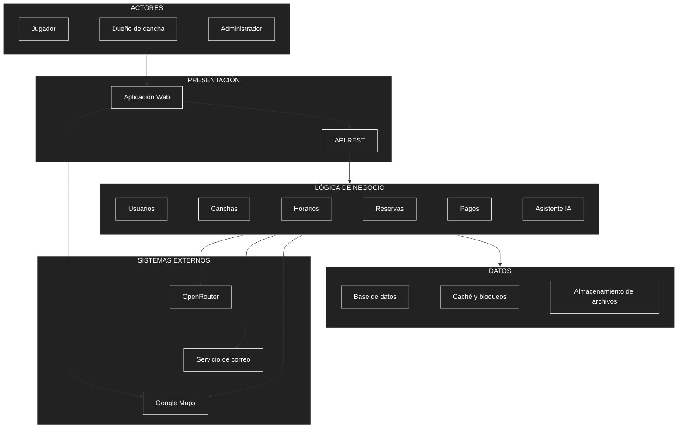

# Arquitectura inicial del sistema

## Diagrama de arquitectura

## Descripción

La arquitectura inicial se organiza en tres capas principales:

- **Presentación:** permite la interacción de los usuarios con el sistema mediante la aplicación web y la API REST.
- **Lógica de negocio:** contiene los principales módulos responsables de las funcionalidades del sistema: usuarios, canchas, horarios, reservas, pagos y asistente IA.
- **Datos:** permite almacenar y consultar la información mediante una base de datos, una caché con bloqueos de horarios y un almacenamiento de archivos para los comprobantes.

Además, los módulos de **Pagos** y **Asistente IA** se integran con **OpenRouter**, el sistema envía avisos mediante el **servicio de correo**, y usa **Google Maps** para mostrar los locales en el mapa (desde la aplicación web) y convertir direcciones en coordenadas (desde el módulo Canchas). La ruta se abre en Google Maps o **Waze** con un enlace. Los pagos por **Yape/Plin** se realizan fuera del sistema: el jugador solo sube la captura del comprobante.
