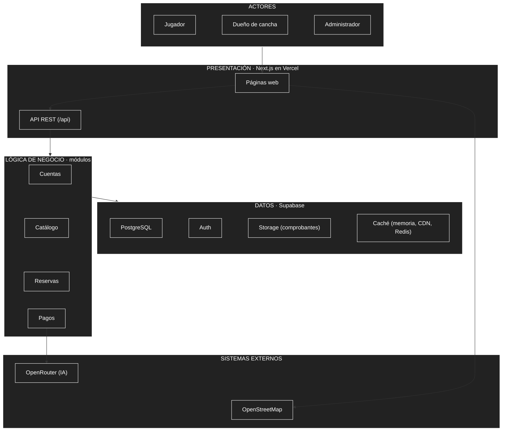

# Arquitectura inicial del sistema

## Diagrama de arquitectura

## Descripción

La arquitectura se organiza en tres capas principales:

- **Presentación:** las páginas web y la API REST, ambas en una sola aplicación Next.js desplegada en Vercel (ADR-009).
- **Lógica de negocio:** los módulos del monolito (`apps/web/src/modules/`): cuentas, catálogo, reservas y pagos, más un módulo compartido. Cada uno se organiza por dentro con Clean Architecture (ADR-002).
- **Datos:** Supabase aporta PostgreSQL (con las reglas críticas en funciones `SECURITY DEFINER` y RLS), la autenticación y el almacenamiento privado de los comprobantes (ADR-010). La caché trabaja en memoria, en el CDN de Vercel y, desde el Sprint 2, en Redis (ADR-004).

El módulo de **Pagos** usa **OpenRouter** para leer los comprobantes con IA. El mapa se dibuja con **OpenStreetMap**, y «Cómo llegar» abre Google Maps o Waze con un enlace (ADR-012). Los pagos por **Yape/Plin** se hacen fuera del sistema: el jugador solo sube la captura del comprobante.
