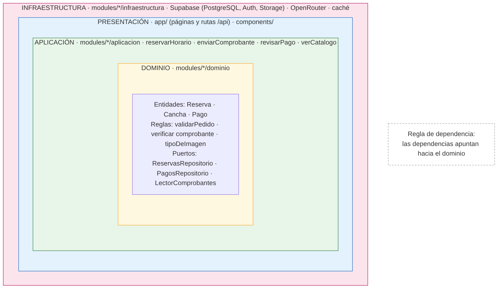

Se utiliza el enfoque Clean Architecture para separar

| Elemento | Descripción aplicada a ReservaYa Ayacucho |
|---|---|
| Patrón / enfoque arquitectónico | Clean Architecture (Arquitectura Limpia), aplicada dentro de cada módulo del monolito. |
| Objetivo | Separar responsabilidades y controlar las dependencias hacia el dominio. |
| ¿Qué problema resuelve? | Evita el acoplamiento entre la interfaz Next.js, las reglas del negocio (reservas, estados del pago, verificación del comprobante) y las tecnologías externas, como Supabase (PostgreSQL, Auth y Storage) y OpenRouter. |
| Capas definidas | **Dominio** (`modules/*/dominio`): entidades, reglas puras y puertos. **Aplicación** (`modules/*/aplicacion`): casos de uso. **Infraestructura** (`modules/*/infraestructura`): repositorios y adaptadores de Supabase y OpenRouter, más la raíz de composición. **Presentación** (`app/` y `components/`): páginas, rutas `/api` y componentes. |
| Regla de dependencia | Las dependencias apuntan hacia el dominio. El dominio no importa Next.js, Supabase ni OpenRouter; la aplicación recibe los puertos por parámetro. |
| Beneficios | • Facilita el mantenimiento y las pruebas unitarias (el dominio y los casos de uso se prueban sin base de datos). • Permite cambiar implementaciones técnicas (por ejemplo, el modelo de IA o la caché) sin modificar las reglas del negocio. • Mejora la organización y separación de responsabilidades del código. |

