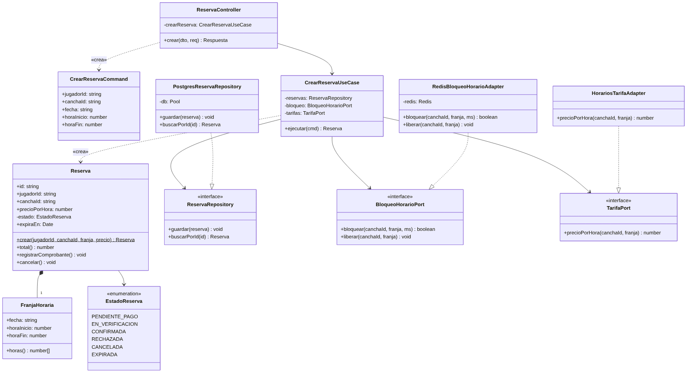
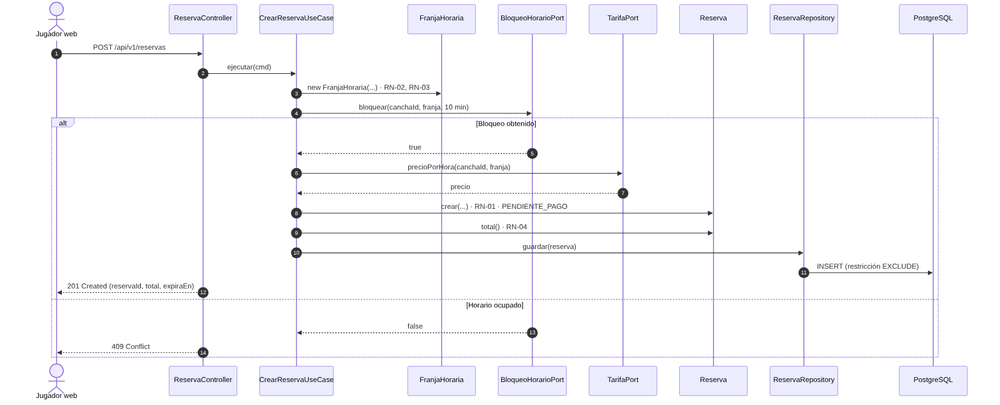

# Diseño interno de módulos

> **Proyecto:** ReservaYa Ayacucho · **Backend:** Node.js + NestJS + TypeScript · **Módulo de referencia:** Reservas  
> **Enfoque arquitectónico:** Clean Architecture dentro de cada módulo del monolito modular  
> **Nivel C4:** 4 – Código · **Versión:** 1.0

---

## 1. Propósito

Este documento describe **cómo se organiza el código dentro de un módulo** del backend. Tiene tres objetivos:

- que todos los módulos se construyan con la misma estructura;
- que las reglas de negocio queden aisladas de la tecnología;
- que cualquier integrante del equipo sepa dónde va cada archivo y de qué puede depender.


## 2. Estructura de carpetas

```text
src/
└── modules/
    └── reservas/
        ├── dominio/
        │   ├── reserva.ts                       Entidad Reserva y sus reglas
        │   ├── franja-horaria.ts                Objeto de valor FranjaHoraria
        │   ├── estado-reserva.ts                Enumeración EstadoReserva
        │   ├── reserva.repository.ts            Interfaz (puerto) de persistencia
        │   ├── bloqueo-horario.port.ts          Interfaz (puerto) de bloqueo de horarios
        │   └── tarifa.port.ts                   Interfaz (puerto) para obtener el precio por hora
        ├── aplicacion/
        │   ├── crear-reserva.use-case.ts        Caso de uso CrearReserva
        │   └── crear-reserva.command.ts         Datos de entrada del caso de uso
        ├── infraestructura/
        │   ├── postgres-reserva.repository.ts   Implementación con PostgreSQL
        │   ├── redis-bloqueo-horario.adapter.ts Implementación con Redis (Upstash)
        │   ├── memoria-bloqueo-horario.adapter.ts Implementación en memoria (pruebas)
        │   └── horarios-tarifa.adapter.ts       Usa la API pública del módulo Horarios
        ├── presentacion/
        │   ├── reserva.controller.ts            Traduce HTTP ⇄ caso de uso
        │   └── crear-reserva.dto.ts             Validación de la petición /api/v1/reservas
        ├── reservas.module.ts                   Raíz de composición del módulo (NestJS)
        └── index.ts                             API pública del módulo
```

| Archivo | Capa | Responsabilidad | Importa de |
|---|---|---|---|
| `reserva.ts` | Dominio | Crear reservas válidas, calcular el total, cambiar de estado | Solo dominio |
| `franja-horaria.ts` | Dominio | Representar fecha, hora de inicio y fin; validar duración y cruces | Nada |
| `estado-reserva.ts` | Dominio | Definir los estados posibles de la reserva | Nada |
| `reserva.repository.ts` | Dominio | Declarar **qué** operaciones de persistencia necesita el módulo | `reserva.ts` |
| `bloqueo-horario.port.ts` | Dominio | Declarar **qué** necesita el módulo para bloquear un horario | `franja-horaria.ts` |
| `tarifa.port.ts` | Dominio | Declarar **qué** necesita el módulo para conocer el precio por hora | `franja-horaria.ts` |
| `crear-reserva.use-case.ts` | Aplicación | Coordinar los pasos de la reserva | Dominio |
| `crear-reserva.command.ts` | Aplicación | Datos de entrada validados del caso de uso | Nada |
| `postgres-reserva.repository.ts` | Infraestructura | Guardar y leer reservas en PostgreSQL | Dominio + driver de BD |
| `redis-bloqueo-horario.adapter.ts` | Infraestructura | Traducir `bloquear()` a comandos de Redis | Dominio + `ioredis` |
| `memoria-bloqueo-horario.adapter.ts` | Infraestructura | Bloquear horarios en memoria para pruebas | Dominio |
| `horarios-tarifa.adapter.ts` | Infraestructura | Pedir el precio al módulo Horarios por su API pública | Dominio + `modules/horarios/index.ts` |
| `reserva.controller.ts` | Presentación | Leer la petición HTTP, invocar el caso de uso y responder | Aplicación |
| `crear-reserva.dto.ts` | Presentación | Validar el cuerpo de la petición con `class-validator` | Nada |
| `reservas.module.ts` | Composición | Registrar las implementaciones concretas e inyectarlas | Todas las capas |
| `index.ts` | Composición | Exponer solo lo que otros módulos pueden usar | `reservas.module.ts` |

---

## 3. Capas del módulo y regla de dependencia


**Regla de dependencia:** el código solo puede importar hacia el centro (dominio). El dominio no conoce NestJS, PostgreSQL ni Redis.

| Capa | Contiene | Responsabilidad | Puede depender de | **No** puede depender de |
|---|---|---|---|---|
| **Dominio** | Entidades, objetos de valor, enumeraciones, interfaces (puertos) | Reglas de negocio que serían ciertas con cualquier tecnología | Nada externo | Aplicación, infraestructura, presentación, NestJS, ORM, Redis |
| **Aplicación** | Casos de uso, comandos | Orquestar el flujo: qué paso va primero y qué hacer si falla | Dominio (y `@nestjs/common` solo para `@Injectable` e `@Inject`) | Infraestructura, presentación, ORM, Redis |
| **Infraestructura** | Repositorios concretos, adaptadores de servicios externos | Implementar las interfaces del dominio con una tecnología | Dominio, librerías externas | Aplicación, presentación |
| **Presentación** | Controladores, DTO | Traducir HTTP a llamadas del caso de uso y viceversa | Aplicación | Infraestructura, base de datos |
| **Composición** | `reservas.module.ts` | Elegir implementaciones concretas y conectarlas | Todas | — |

> **Cómo comprobarlo en el código:** basta revisar los `import` de `dominio/`. Si aparece `@nestjs`, `pg`, `ioredis` o cualquier archivo de `infraestructura/`, la regla se rompió.

---

## 4. Diagrama de clases



### 4.1 Notación UML utilizada

| Símbolo | Significado | Ejemplo en el diagrama |
|---|---|---|
| Línea continua con flecha abierta | Asociación: la clase guarda una referencia a la otra | `CrearReservaUseCase` → `ReservaRepository` |
| Línea discontinua con flecha abierta | Dependencia: la usa o la crea, pero no la guarda | `ReservaController` «crea» `CrearReservaCommand` |
| Línea discontinua con triángulo hueco | Realización: implementa una interfaz | `PostgresReservaRepository` ▷ `ReservaRepository` |
| Rombo relleno | Composición: la parte no existe sin el todo | `Reserva` ◆ `FranjaHoraria` (1) |
| Nombre en cursiva + «interface» | Interfaz (contrato sin implementación) | `ReservaRepository`, `BloqueoHorarioPort` |
| `-` / `+` | Privado / público | `- estado`, `+ total()` |


## 5. Flujo de ejecución: crear reserva



| Paso | Origen → destino | Acción | Capa |
|---|---|---|---|
| 1 | Jugador web → `ReservaController` | `POST /api/v1/reservas` con `canchaId`, `fecha`, `horaInicio` y `horaFin` | Presentación |
| 2 | `ReservaController` → `CrearReservaUseCase` | `ejecutar(cmd)` | Presentación → Aplicación |
| 3 | `CrearReservaUseCase` → `FranjaHoraria` | Se crea la franja; se validan RN-02 y RN-03 | Aplicación → Dominio |
| 4 | `CrearReservaUseCase` → `BloqueoHorarioPort` | `bloquear(canchaId, franja, 10 min)` | Aplicación → Dominio (interfaz) |
| 5 | `RedisBloqueoHorarioAdapter` → Redis | `SET ... NX PX 600000` por cada hora de la franja | Infraestructura → caché |
| 6 | `CrearReservaUseCase` → `TarifaPort` | `precioPorHora(canchaId, franja)` (hora pico o normal) | Aplicación → Dominio (interfaz) |
| 7 | `CrearReservaUseCase` → `Reserva` | `crear(...)`; se valida RN-01; estado PENDIENTE_PAGO; `total()` (RN-04) | Aplicación → Dominio |
| 8 | `CrearReservaUseCase` → `ReservaRepository` | `guardar(reserva)` | Aplicación → Dominio (interfaz) |
| 9 | `PostgresReservaRepository` → PostgreSQL | `INSERT` de la reserva; la restricción `EXCLUDE` impide cruces | Infraestructura → BD |
| 10 | `ReservaController` → Jugador web | `201 Created` con `reservaId`, `total` y `expiraEn` | Presentación |
| 11 | Alternativa | Si el horario ya está bloqueado o cruzado: no se guarda y se responde `409 Conflict` | Aplicación → Presentación |
| 12 | Alternativa | Si no se sube el comprobante antes de `expiraEn`, una tarea programada marca la reserva como EXPIRADA | Aplicación |


## 6. Código de referencia

### 6.1 Dominio · entidad e interfaces

```ts
// dominio/franja-horaria.ts
import { ReglaNegocioError } from '../../../shared/errores';

export class FranjaHoraria {
  constructor(
    readonly fecha: string,      // '2026-11-07'
    readonly horaInicio: number, // 19 → 7:00 p. m.
    readonly horaFin: number,    // 21 → 9:00 p. m.
  ) {
    if (horaFin <= horaInicio) throw new ReglaNegocioError('RN-02: la hora de fin debe ser mayor que la de inicio');
    if (new Date(`${fecha}T${String(horaInicio).padStart(2, '0')}:00:00-05:00`) < new Date()) {
      throw new ReglaNegocioError('RN-03: no se puede reservar un horario pasado');
    }
  }

  horas(): number[] {
    return Array.from({ length: this.horaFin - this.horaInicio }, (_, i) => this.horaInicio + i);
  }
}
```

```ts
// dominio/reserva.ts
import { FranjaHoraria } from './franja-horaria';
import { EstadoReserva } from './estado-reserva';
import { ReglaNegocioError } from '../../../shared/errores';

export class Reserva {
  private constructor(
    readonly id: string,
    readonly jugadorId: string,
    readonly canchaId: string,
    readonly franja: FranjaHoraria,
    readonly precioPorHora: number,
    private estado: EstadoReserva,
    readonly expiraEn: Date,
  ) {}

  static crear(jugadorId: string, canchaId: string, franja: FranjaHoraria, precioPorHora: number): Reserva {
    if (!jugadorId || !canchaId) throw new ReglaNegocioError('RN-01: la reserva debe tener jugador y cancha');
    const expiraEn = new Date(Date.now() + 10 * 60 * 1000);   // 10 minutos para pagar
    return new Reserva(crypto.randomUUID(), jugadorId, canchaId, franja, precioPorHora,
      EstadoReserva.PENDIENTE_PAGO, expiraEn);
  }

  total(): number {                                              // RN-04
    return this.franja.horas().length * this.precioPorHora;
  }

  registrarComprobante(): void {                                 // RN-05
    if (this.estado !== EstadoReserva.PENDIENTE_PAGO) {
      throw new ReglaNegocioError('RN-05: solo una reserva pendiente de pago puede recibir comprobante');
    }
    this.estado = EstadoReserva.EN_VERIFICACION;
  }

  cancelar(ahora = new Date()): void {                           // RN-06
    const inicio = new Date(`${this.franja.fecha}T${String(this.franja.horaInicio).padStart(2, '0')}:00:00-05:00`);
    if (inicio.getTime() - ahora.getTime() < 2 * 60 * 60 * 1000) {
      throw new ReglaNegocioError('RN-06: solo se puede cancelar hasta 2 horas antes');
    }
    this.estado = EstadoReserva.CANCELADA;
  }

  get estadoActual(): EstadoReserva { return this.estado; }
}
```

```ts
// dominio/reserva.repository.ts
import { Reserva } from './reserva';

export const RESERVA_REPOSITORY = Symbol('RESERVA_REPOSITORY');

export interface ReservaRepository {
  guardar(reserva: Reserva): Promise<void>;          // lanza HorarioOcupadoError si hay cruce
  buscarPorId(id: string): Promise<Reserva | null>;
}
```

```ts
// dominio/bloqueo-horario.port.ts
import { FranjaHoraria } from './franja-horaria';

export const BLOQUEO_HORARIO_PORT = Symbol('BLOQUEO_HORARIO_PORT');

export interface BloqueoHorarioPort {
  bloquear(canchaId: string, franja: FranjaHoraria, duracionMs: number): Promise<boolean>;
  liberar(canchaId: string, franja: FranjaHoraria): Promise<void>;
}
```

### 6.2 Aplicación · caso de uso

```ts
// aplicacion/crear-reserva.use-case.ts
import { Inject, Injectable } from '@nestjs/common';
import { Reserva } from '../dominio/reserva';
import { FranjaHoraria } from '../dominio/franja-horaria';
import { RESERVA_REPOSITORY, ReservaRepository } from '../dominio/reserva.repository';
import { BLOQUEO_HORARIO_PORT, BloqueoHorarioPort } from '../dominio/bloqueo-horario.port';
import { TARIFA_PORT, TarifaPort } from '../dominio/tarifa.port';
import { CrearReservaCommand } from './crear-reserva.command';
import { HorarioOcupadoError } from '../../../shared/errores';

const DIEZ_MINUTOS = 10 * 60 * 1000;

@Injectable()
export class CrearReservaUseCase {
  constructor(
    @Inject(RESERVA_REPOSITORY) private readonly reservas: ReservaRepository,  // interfaz, no PostgreSQL
    @Inject(BLOQUEO_HORARIO_PORT) private readonly bloqueo: BloqueoHorarioPort, // interfaz, no Redis
    @Inject(TARIFA_PORT) private readonly tarifas: TarifaPort,
  ) {}

  async ejecutar(cmd: CrearReservaCommand): Promise<Reserva> {
    const franja = new FranjaHoraria(cmd.fecha, cmd.horaInicio, cmd.horaFin);

    const bloqueado = await this.bloqueo.bloquear(cmd.canchaId, franja, DIEZ_MINUTOS);
    if (!bloqueado) throw new HorarioOcupadoError();

    try {
      const precio = await this.tarifas.precioPorHora(cmd.canchaId, franja); // el precio NO viene del frontend
      const reserva = Reserva.crear(cmd.jugadorId, cmd.canchaId, franja, precio);
      await this.reservas.guardar(reserva);
      return reserva;
    } catch (error) {
      await this.bloqueo.liberar(cmd.canchaId, franja);
      throw error;
    }
  }
}
```

> El bloqueo en Redis da una respuesta inmediata al segundo jugador. La garantía final está en PostgreSQL (ver 6.3): aunque Redis fallara, la base de datos no acepta dos reservas cruzadas.

### 6.3 Infraestructura · adaptador y restricción en la base de datos

```ts
// infraestructura/redis-bloqueo-horario.adapter.ts
import { Injectable } from '@nestjs/common';
import Redis from 'ioredis';
import { BloqueoHorarioPort } from '../dominio/bloqueo-horario.port';
import { FranjaHoraria } from '../dominio/franja-horaria';

@Injectable()
export class RedisBloqueoHorarioAdapter implements BloqueoHorarioPort {
  constructor(private readonly redis: Redis) {}

  private clave(canchaId: string, fecha: string, hora: number): string {
    return `bloqueo:${canchaId}:${fecha}:${hora}`;
  }

  async bloquear(canchaId: string, franja: FranjaHoraria, duracionMs: number): Promise<boolean> {
    const obtenidas: number[] = [];
    for (const hora of franja.horas()) {
      // NX: solo si nadie más tiene la clave · PX: se borra sola al vencer
      const ok = await this.redis.set(this.clave(canchaId, franja.fecha, hora), '1', 'PX', duracionMs, 'NX');
      if (ok !== 'OK') {
        await Promise.all(obtenidas.map((h) => this.redis.del(this.clave(canchaId, franja.fecha, h))));
        return false;
      }
      obtenidas.push(hora);
    }
    return true;
  }

  async liberar(canchaId: string, franja: FranjaHoraria): Promise<void> {
    await Promise.all(franja.horas().map((h) => this.redis.del(this.clave(canchaId, franja.fecha, h))));
  }
}
```

```sql
-- Restricción en PostgreSQL: dos reservas activas de la misma cancha no pueden cruzarse
CREATE EXTENSION IF NOT EXISTS btree_gist;

ALTER TABLE reservas
  ADD CONSTRAINT reservas_sin_cruce
  EXCLUDE USING gist (cancha_id WITH =, rango WITH &&)
  WHERE (estado IN ('PENDIENTE_PAGO', 'EN_VERIFICACION', 'CONFIRMADA'));
-- rango es una columna tstzrange: [inicio, fin)
```

### 6.4 Presentación · controlador

```ts
// presentacion/reserva.controller.ts
import { Body, Controller, Post, Req, UseGuards } from '@nestjs/common';
import { JwtAuthGuard } from '../../../api/guards/jwt-auth.guard';
import { CrearReservaUseCase } from '../aplicacion/crear-reserva.use-case';
import { CrearReservaDto } from './crear-reserva.dto';

@Controller('api/v1/reservas')
@UseGuards(JwtAuthGuard)
export class ReservaController {
  constructor(private readonly crearReserva: CrearReservaUseCase) {}

  @Post()
  async crear(@Body() dto: CrearReservaDto, @Req() req: { user: { id: string } }) {
    const reserva = await this.crearReserva.ejecutar({
      jugadorId: req.user.id,            // lo agrega el guard JWT; no viene del body
      canchaId: dto.canchaId,
      fecha: dto.fecha,
      horaInicio: dto.horaInicio,
      horaFin: dto.horaFin,
    });
    return { reservaId: reserva.id, total: reserva.total(), expiraEn: reserva.expiraEn }; // 201 Created
  }
}
```

### 6.5 Raíz de composición

```ts
// reservas.module.ts
import { Module } from '@nestjs/common';
import { HorariosModule } from '../horarios';
import { RESERVA_REPOSITORY } from './dominio/reserva.repository';
import { BLOQUEO_HORARIO_PORT } from './dominio/bloqueo-horario.port';
import { TARIFA_PORT } from './dominio/tarifa.port';
import { PostgresReservaRepository } from './infraestructura/postgres-reserva.repository';
import { RedisBloqueoHorarioAdapter } from './infraestructura/redis-bloqueo-horario.adapter';
import { HorariosTarifaAdapter } from './infraestructura/horarios-tarifa.adapter';
import { CrearReservaUseCase } from './aplicacion/crear-reserva.use-case';
import { ReservaController } from './presentacion/reserva.controller';

@Module({
  imports: [HorariosModule],
  controllers: [ReservaController],
  providers: [
    CrearReservaUseCase,
    { provide: RESERVA_REPOSITORY, useClass: PostgresReservaRepository },
    { provide: BLOQUEO_HORARIO_PORT, useClass: RedisBloqueoHorarioAdapter }, // pruebas = MemoriaBloqueoHorarioAdapter
    { provide: TARIFA_PORT, useClass: HorariosTarifaAdapter },
  ],
  exports: [CrearReservaUseCase],
})
export class ReservasModule {}
```
