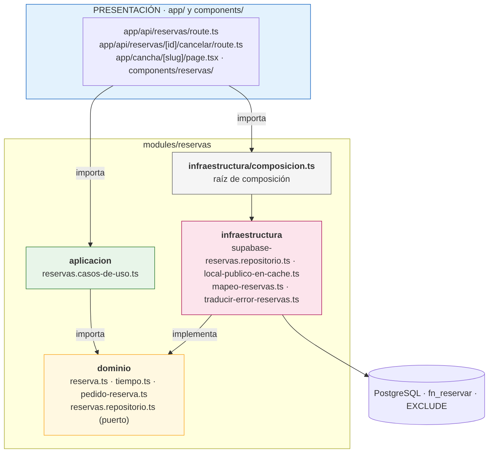

# Diseño interno de módulos

> **Proyecto:** ReservaYa Ayacucho · **Aplicación:** `apps/web` (Next.js 16 + TypeScript) · **Módulo de referencia:** Reservas  
> **Enfoque arquitectónico:** Clean Architecture dentro de cada módulo del monolito modular  
> **Nivel C4:** 4 – Código · **Versión:** 2.1 (22/11/2026: módulo Asistente)

---

## 1. Propósito

Este documento describe **cómo se organiza el código dentro de un módulo**. Tiene tres objetivos:

- que todos los módulos se construyan con la misma estructura;
- que las reglas de negocio queden aisladas de la tecnología;
- que cualquier integrante del equipo sepa dónde va cada archivo y de qué puede depender.

---

## 2. Módulos del sistema

```text
apps/web/src/
├── app/                      PRESENTACIÓN: páginas y API REST (app/api/**/route.ts)
├── components/               PRESENTACIÓN: componentes de React
├── proxy.ts                  Renueva la sesión y protege las páginas privadas
└── modules/
    ├── compartido/           Error de la aplicación, validaciones, clientes de Supabase y OpenRouter
    ├── cuentas/              Roles y perfil de quien navega
    ├── catalogo/             Canchas publicadas, registro y aprobación
    ├── reservas/             Grilla de horarios, reservar y cancelar
    ├── pagos/                Comprobantes Yape/Plin, lectura con IA y revisión del dueño
    ├── agenda/               Agenda del dueño: reservas por teléfono, cobros, bloqueos
    ├── locales/              Configuración del local (reglas, servicios, canchas) y control del admin
    ├── usuarios/             Gestión de cuentas por el admin: rol, suspender, reactivar
    ├── soporte/              WhatsApp de ayuda de la plataforma (enlaces wa.me)
    └── asistente/            Chat de canchas: reglas + IA, horas libres reales y dudas frecuentes
```

Cada módulo tiene las mismas carpetas:

| Carpeta | Capa | Qué contiene | Puede importar |
|---|---|---|---|
| `dominio/` | Dominio | Entidades, reglas puras y **puertos** (interfaces) | Solo otros archivos de dominio |
| `aplicacion/` | Aplicación | **Casos de uso**: coordinan los pasos y reciben los puertos por parámetro | Dominio |
| `infraestructura/` | Infraestructura | **Repositorios y adaptadores** (Supabase, OpenRouter, caché) y la **raíz de composición** | Dominio, aplicación y librerías externas |
| `presentacion/` | Presentación | Ayudas para la interfaz (hooks del navegador, respuestas HTTP) | Dominio |

> **Regla de dependencia:** el código solo importa hacia el dominio. Para comprobarlo basta revisar los `import` de cualquier carpeta `dominio/`: no aparece `next`, `@supabase` ni nada de `infraestructura/`.

---

## 3. Estructura del módulo Reservas

```text
modules/reservas/
├── dominio/
│   ├── reserva.ts                       Entidades: LocalPublico, Turno, Reserva, estados
│   ├── tiempo.ts                        Fechas y horas en hora de Ayacucho, formatos
│   ├── pedido-reserva.ts                PedidoReserva y la regla validarPedido()
│   └── reservas.repositorio.ts          Puerto ReservasRepositorio (interfaz)
├── aplicacion/
│   └── reservas.casos-de-uso.ts         verLocal, verDisponibilidad, reservarHorario,
│                                        verMisReservas, cancelarReserva
└── infraestructura/
    ├── supabase-reservas.repositorio.ts Implementa el puerto con funciones de PostgreSQL
    ├── local-publico-en-cache.ts        Ficha del local con "use cache" (1 min)
    ├── mapeo-reservas.ts                Filas de Supabase -> entidades del dominio
    ├── traducir-error-reservas.ts       Errores de la base -> códigos de la aplicación
    └── composicion.ts                   reservasPublicas() y reservasConSesion(db)
```

La presentación del módulo está en `app/cancha/[slug]/page.tsx`, `app/reservas/[id]/page.tsx`, `app/api/reservas/**` y `components/reservas/`.

---

## 4. Capas del módulo y regla de dependencia



| Capa | Responsabilidad en Reservas | **No** puede depender de |
|---|---|---|
| **Dominio** | Qué es una reserva válida (`validarPedido`), sus estados y cuáles ocupan el horario (`esActiva`) | Next.js, Supabase, infraestructura |
| **Aplicación** | Validar la entrada y pedir al repositorio que reserve, liste o cancele | Supabase, Next.js |
| **Infraestructura** | Llamar a `fn_reservar`, `fn_mis_reservas`, etc. y traducir sus errores | Presentación |
| **Presentación** | Recibir `POST /api/reservas`, llamar al caso de uso y responder `201` o el error | Tablas o SQL directamente |

---

## 5. Diagrama de clases


| Símbolo | Significado | Ejemplo |
|---|---|---|
| Línea continua con flecha | Usa o recibe | `reservarHorario` → `ReservasRepositorio` |
| Línea discontinua con triángulo hueco | Implementa una interfaz | `SupabaseReservasRepositorio` ▷ `ReservasRepositorio` |
| «interface» | Puerto (contrato sin implementación) | `ReservasRepositorio` |

---

## 6. Flujo de ejecución: reservar un horario


| Paso | Origen → destino | Acción | Capa |
|---|---|---|---|
| 1 | Navegador → `POST /api/reservas` | Envía `{ canchaId, inicio, fin, clave }` con la cookie de sesión | Presentación |
| 2 | Ruta → `crearClienteServidor()` | Cliente de Supabase con la sesión de quien pide | Infraestructura |
| 3 | Ruta → `reservarHorario(repo, cuerpo)` | Ejecuta el caso de uso | Aplicación |
| 4 | Caso de uso → `validarPedido()` | Revisa el formato (UUID, fechas, clave de 8 a 64 caracteres) | Dominio |
| 5 | Caso de uso → `repo.reservar(pedido)` | Llama al puerto | Aplicación → Dominio (interfaz) |
| 6 | `SupabaseReservasRepositorio` → `fn_reservar` | En **una transacción**: libera apartados vencidos, calcula el precio turno por turno, revisa el límite de 2 reservas por pagar e inserta | Infraestructura → PostgreSQL |
| 7 | PostgreSQL | La restricción `EXCLUDE` impide cualquier cruce, aunque lleguen dos pedidos a la vez; la clave de idempotencia devuelve la misma reserva si el pedido se repite | Base de datos |
| 8 | Ruta → navegador | `201 Created` con código, total, adelanto y hora de vencimiento | Presentación |
| 9 | Alternativa | Horario tomado → `409 HORARIO_OCUPADO`; datos inválidos → `400` | Presentación |

---

## 7. Código de referencia (extractos del código real)

### 7.1 Dominio · puerto del repositorio

```ts
// modules/reservas/dominio/reservas.repositorio.ts
export interface ReservasRepositorio {
  leerLocal(slug: string): Promise<LocalPublico | null>;
  disponibilidad(localId: string, fecha: string): Promise<Turno[]>;
  reservar(pedido: PedidoReserva): Promise<ReservaCreada>;
  misReservas(id?: string): Promise<Reserva[]>;
  cancelar(id: string, motivo?: string): Promise<{ conDevolucion: boolean }>;
}
```

### 7.2 Dominio · regla pura

```ts
// modules/reservas/dominio/pedido-reserva.ts
export function validarPedido(x: unknown): PedidoReserva {
  const o = (x ?? {}) as Record<string, unknown>;
  const canchaId = String(o.canchaId ?? "");
  const inicio = String(o.inicio ?? "");
  const fin = String(o.fin ?? "");
  const clave = String(o.clave ?? "");
  const fecha = (s: string) => !Number.isNaN(Date.parse(s));
  if (!esUUID(canchaId) || !fecha(inicio) || !fecha(fin) || !/^[A-Za-z0-9-]{8,64}$/.test(clave)) throw datosInvalidos();
  return { canchaId, inicio: new Date(inicio).toISOString(), fin: new Date(fin).toISOString(), clave };
}
```

### 7.3 Aplicación · caso de uso

```ts
// modules/reservas/aplicacion/reservas.casos-de-uso.ts
/** Reservar un horario (RF04). La base de datos garantiza que no haya cruces. */
export function reservarHorario(repo: ReservasRepositorio, datos: unknown) {
  return repo.reservar(validarPedido(datos));
}
```

### 7.4 Infraestructura · repositorio con Supabase

```ts
// modules/reservas/infraestructura/supabase-reservas.repositorio.ts
export class SupabaseReservasRepositorio implements ReservasRepositorio {
  constructor(private readonly db: SupabaseClient) {}

  async reservar(p: PedidoReserva): Promise<ReservaCreada> {
    const { data, error } = await this.db.rpc("fn_reservar", {
      p_cancha_id: p.canchaId, p_inicio: p.inicio, p_fin: p.fin, p_clave: p.clave,
    });
    if (error) throw traducirErrorReservas(error);
    return aReservaCreada(data);
  }
  // ...
}
```

```sql
-- En la base de datos (esquema inicial): nunca dos reservas activas cruzadas en la misma cancha
EXCLUDE USING gist (court_id WITH =, period WITH &&)
```

### 7.5 Raíz de composición y presentación

```ts
// modules/reservas/infraestructura/composicion.ts
export const reservasConSesion = (db: SupabaseClient): ReservasRepositorio => new SupabaseReservasRepositorio(db);

// app/api/reservas/route.ts
export async function POST(request: Request) {
  try {
    const cuerpo = await request.json().catch(() => null);
    const reserva = await reservarHorario(reservasConSesion(await crearClienteServidor()), cuerpo);
    return NextResponse.json({ ok: true, reserva }, { status: 201, headers: SIN_CACHE_PRIVADO });
  } catch (e) {
    return respuestaError(e);
  }
}
```

---

## 8. Los otros módulos siguen la misma forma

| Módulo | Puertos (dominio) | Casos de uso (aplicación) | Implementaciones (infraestructura) |
|---|---|---|---|
| Catálogo | `CatalogoRepositorio` | `verCatalogo`, `registrarCancha`, `corregirCancha`, `quitarCancha`, `verPendientes`, `verMisPublicadas`, `revisarCancha` | `SupabaseCatalogoRepositorio`, `CatalogoEnCache` (Decorator) |
| Reservas | `ReservasRepositorio` | `verLocal`, `verDisponibilidad`, `reservarHorario`, `verMisReservas`, `cancelarReserva` | `SupabaseReservasRepositorio` |
| Pagos | `PagosRepositorio`, `AlmacenComprobantes`, `LectorComprobantes` | `enviarComprobante`, `verEstadoPago`, `verPagosPorRevisar`, `revisarPago`, `verMisLocalesPago`, `guardarDatosPago` | `SupabasePagosRepositorio`, `SupabaseAlmacenComprobantes`, `OpenRouterLectorComprobantes` |
| Cuentas | — | `obtenerCuenta`, `obtenerPerfil` (perfil activo o suspensión con motivo) | Supabase Auth + `fn_mi_perfil` |
| Agenda | `AgendaRepositorio` | `verLocalesConAgenda`, `verAgenda`, `anotarReserva`, `gestionarReserva`, `bloquearHorario`, `quitarBloqueo` | `SupabaseAgendaRepositorio` |
| Locales | `LocalesRepositorio` | `verMisLocales`, `verConfiguracion`, `guardarAjustesLocal`, `guardarServiciosLocal`, `guardarCanchaDelLocal`, `agregarCanchaAlLocal`, `quitarCanchaDelLocal`, `verLocalesAdmin`, `gestionarLocal` | `SupabaseLocalesRepositorio`, `LocalesConVistasFrescas` (Decorator: renueva la ficha y el mapa) |
| Usuarios | `UsuariosRepositorio` | `verUsuarios`, `gestionarUsuario` | `SupabaseUsuariosRepositorio` |
| Soporte | `AjustesRepositorio` | `verAjustesPublicos`, `guardarAjustesPlataforma` | `SupabaseAjustesRepositorio`, lectura con `"use cache"` y Decorator que renueva la caché al guardar |
| Asistente | `FuenteCanchas`, `InterpreteIA`, `ControlIA` | `consultarAsistente` (reglas → IA si hace falta → búsqueda en datos reales) | `fuentePublica()` (catálogo en caché, ficha `"use cache"` y grilla), `OpenRouterInterprete` (Adapter), `SupabaseControlIA` (cupo, configuración y registro) |

Los enlaces de WhatsApp (`enlaceWhatsApp()` y los mensajes ya escritos) son funciones puras del dominio de `compartido`, porque los usan varios módulos (reservas, pagos, locales, usuarios, soporte). Por la misma razón, el cliente de OpenRouter (`pedirJSON`: modelos de respaldo, JSON con esquema, registro de cada llamada) está en `compartido/infraestructura/openrouter.ts` y lo usan los adaptadores de pagos y del asistente.

En el asistente, el dominio hace casi todo el trabajo con funciones puras que se prueban sin red: `interpretarConReglas()` entiende el mensaje, `evaluarLocal()` elige las horas libres de la grilla y `redactarBusqueda()` arma el texto. La IA solo reemplaza al intérprete cuando las reglas no están seguras, y su respuesta pasa por `validarInterpretacionIA()` antes de usarse (ADR-015).
