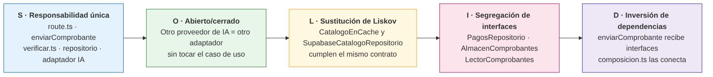

# Principios de diseño (SOLID)

## Objetivo

Documentar cómo se aplican los principios SOLID en ReservaYa Ayacucho, organizado con Clean Architecture, para que cada módulo se programe de forma uniforme y las reglas de negocio no dependan de la tecnología.

## Contexto

- **Estilo:** monolito modular (Next.js 16).
- **Enfoque interno:** Clean Architecture (dominio, aplicación, infraestructura, presentación).
- **Módulo de referencia:** Pagos, porque integra base de datos, almacén de archivos e IA. Rutas relativas a `apps/web/src/modules/`.

## SOLID en el módulo Pagos

| Principio | Dónde se aplica (capa) | Cómo se cumple en ReservaYa | Archivos |
|---|---|---|---|
| **S** · Responsabilidad única | Todas las capas | Cada archivo tiene una sola tarea: la ruta recibe el formulario HTTP, `enviarComprobante` coordina los pasos, `verificar.ts` compara lo que leyó la IA, el repositorio habla con PostgreSQL y el adaptador con OpenRouter | `app/api/reservas/[id]/pago/route.ts`, `pagos/aplicacion/enviar-comprobante.ts`, `pagos/dominio/verificar.ts`, `pagos/infraestructura/supabase-pagos.repositorio.ts`, `pagos/infraestructura/openrouter-lector.ts` |
| **O** · Abierto/cerrado | Infraestructura | Para leer comprobantes con otro proveedor de IA se crea un nuevo adaptador de `LectorComprobantes`; el caso de uso no se modifica | `pagos/dominio/pagos.puertos.ts`, `pagos/infraestructura/openrouter-lector.ts` |
| **L** · Sustitución de Liskov | Infraestructura | `CatalogoEnCache` y `SupabaseCatalogoRepositorio` cumplen el mismo contrato: el caso de uso funciona igual con cualquiera de los dos | `catalogo/infraestructura/catalogo-en-cache.ts`, `catalogo/infraestructura/supabase-catalogo.repositorio.ts` |
| **I** · Segregación de interfaces | Dominio | Pagos tiene tres interfaces pequeñas en lugar de una grande: `PagosRepositorio` (datos), `AlmacenComprobantes` (archivos) y `LectorComprobantes` (IA) | `pagos/dominio/pagos.puertos.ts` |
| **D** · Inversión de dependencias | Aplicación | `enviarComprobante` recibe las interfaces por parámetro y no conoce Supabase ni OpenRouter; las implementaciones se conectan en la raíz de composición | `pagos/aplicacion/enviar-comprobante.ts`, `pagos/infraestructura/composicion.ts` |

## Qué pasaría sin SOLID en ReservaYa

| Situación real | Sin SOLID | Con SOLID |
|---|---|---|
| Se cambia el modelo gratuito de OpenRouter | Se modifica el código de pagos | Se cambia una fila de `ai_model_configs` |
| Se quiere probar el envío del comprobante | Se necesita Supabase y OpenRouter reales | Se prueba con implementaciones falsas en memoria |
| Se agrega Redis como caché | Hay que tocar las rutas y los casos de uso | Se crea otro decorador del repositorio |
| Cambia la regla para comparar el destinatario | Hay que buscarla en varias rutas | Está solo en `pagos/dominio/verificar.ts` |

## Relación con Clean Architecture y los patrones

| Principio | Lo cumple en el proyecto |
|---|---|
| Responsabilidad única | La separación en capas de Clean Architecture |
| Abierto/cerrado y Liskov | Los patrones Adapter y Decorator |
| Segregación de interfaces | Los puertos pequeños del dominio |
| Inversión de dependencias | El patrón Repository y la raíz de composición de cada módulo |
