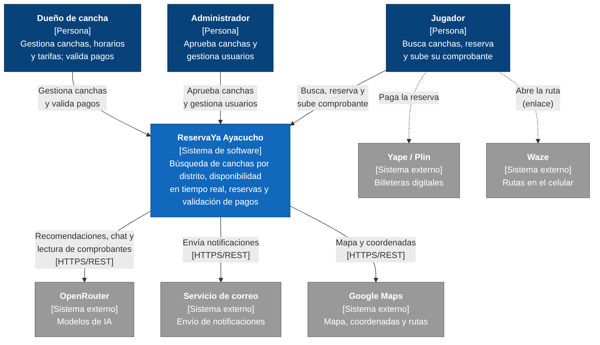

# Nivel 1 · Diagrama de contexto del sistema

> **Proyecto:** ReservaYa Ayacucho  
> **Modelo:** C4 · Nivel 1 de 4 · **Versión:** 1.0

---

## 1. Objetivo

Mostrar **ReservaYa Ayacucho como una sola caja**: quiénes lo usan y con qué sistemas externos se comunica. Es la vista de mayor nivel y la primera que se presenta a cualquier persona, técnica o no.

| Aspecto               | Descripción                                                           |
|-----------------------|-----------------------------------------------------------------------|
| Pregunta que responde | ¿Qué es el sistema, quién lo usa y con quién se integra?              |
| Audiencia             | Todos: dueños de canchas, docentes, equipo de desarrollo, operaciones |
| Qué **no** muestra    | Tecnologías, servidores, bases de datos ni módulos internos           |
| Siguiente nivel       | `Nivel2-DiagramadeContenedores.md`                                    |

---

## 2. Diagrama

> Archivo editable: `img/fuentes-svg/nivel1-contexto.mmd`

---

## 3. Personas (usuarios)

| Persona             | Descripción                                         | Qué hace en el sistema                                                                                                        |
|---------------------|-----------------------------------------------------|-------------------------------------------------------------------------------------------------------------------------------|
| **Jugador**         | Persona que reserva canchas para jugar              | Busca canchas por distrito, ve la disponibilidad en tiempo real, reserva, sube su comprobante de pago y consulta sus reservas |
| **Dueño de cancha** | Propietario que ofrece sus canchas en la plataforma | Registra sus locales y canchas, define horarios, tarifas y servicios, y valida las reservas y pagos                           |
| **Administrador**   | Responsable de la operación de la plataforma        | Aprueba canchas nuevas, gestiona usuarios y revisa estadísticas                                                               |

---

## 4. Sistemas

| Sistema                | Tipo               | Responsabilidad                                                                                          | Quién lo construye                  |
|------------------------|--------------------|----------------------------------------------------------------------------------------------------------|-------------------------------------|
| **ReservaYa Ayacucho** | Sistema en alcance | Permite a los dueños publicar sus canchas y a los jugadores reservarlas y pagarlas sin cruces de horario | El equipo del proyecto              |
| **Yape / Plin**        | Sistema externo    | Billeteras digitales donde el jugador paga la reserva al dueño                                           | Bancos (BCP, Interbank y asociados) |
| **OpenRouter**         | Sistema externo    | Da acceso a modelos de IA para recomendaciones, chat de soporte y lectura de comprobantes                | Proveedor OpenRouter                |
| **Servicio de correo** | Sistema externo    | Envía confirmaciones, recordatorios y avisos de reservas                                                 | Proveedor de correo (Resend)        |
| **Google Maps**        | Sistema externo    | Muestra los locales en el mapa, convierte direcciones en coordenadas y traza la ruta                    | Google                              |
| **Waze**               | Sistema externo    | Traza la ruta hasta el local en el celular del jugador                                                   | Google (Waze)                       |

---

## 5. Relaciones

| Origen             | Destino            | Descripción                                                            | Protocolo  |
|--------------------|--------------------|------------------------------------------------------------------------|------------|
| Jugador            | ReservaYa Ayacucho | Busca canchas, reserva y sube su comprobante                           | —          |
| Dueño de cancha    | ReservaYa Ayacucho | Gestiona sus canchas, horarios y tarifas, y valida pagos               | —          |
| Administrador      | ReservaYa Ayacucho | Aprueba canchas, gestiona usuarios y revisa estadísticas               | —          |
| Jugador            | Yape / Plin        | Paga la reserva desde su aplicación                                    | —          |
| ReservaYa Ayacucho | OpenRouter         | Solicita recomendaciones, respuestas de chat y lectura de comprobantes | HTTPS/REST |
| ReservaYa Ayacucho | Servicio de correo | Envía notificaciones y recordatorios de reservas                       | HTTPS/REST |
| ReservaYa Ayacucho | Google Maps        | Muestra el mapa de locales y obtiene coordenadas de las direcciones    | HTTPS/REST |
| Jugador            | Waze / Google Maps | Abre la ruta hasta el local desde el enlace «Cómo llegar»              | —          |

> En el nivel 1 no se indica el protocolo entre personas y sistema: eso se detalla en el nivel 2.

---

## 6. Decisiones y supuestos

| \# | Decisión o supuesto                                    | Motivo                                                                                                                                  |
|----|--------------------------------------------------------|-----------------------------------------------------------------------------------------------------------------------------------------|
| 1  | ReservaYa **no se conecta directamente con Yape/Plin** | No ofrecen una API pública de cobros; el jugador paga en su app y sube la captura del comprobante, que la IA revisa y el dueño confirma |
| 2  | ReservaYa **no almacena datos bancarios**              | Solo guarda la imagen del comprobante y el estado del pago; se reduce el riesgo de seguridad                                            |
| 3  | Los sistemas externos no se modifican                  | Son de terceros; ReservaYa se adapta a ellos (patrón Adapter)                                                                           |
| 4  | Waze se usa **solo con un enlace**                     | Waze no ofrece una API para mostrar su mapa dentro de la web; el botón «Ir con Waze» abre la app con las coordenadas del local          |
| 5  | Las coordenadas del local se piden a Google Maps **una sola vez** | Se guardan en la base de datos al registrar el local; así la búsqueda «cerca de mí» no genera costo en Google                 |
| 6  | Las notificaciones se envían por **correo**            | No requiere aprobación de plantillas como WhatsApp; WhatsApp se evaluará en una siguiente iteración                                    |

---
