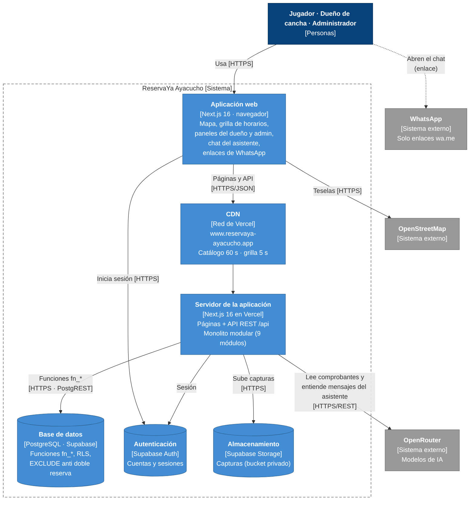

# Nivel 2 · Diagrama de contenedores

> **Proyecto:** ReservaYa Ayacucho  
> **Modelo:** C4 · Nivel 2 de 4 · **Versión:** 2.2 (22/11/2026: asistente de canchas con IA; antes, 21/11/2026: módulos de agenda, locales, usuarios y soporte y enlaces de WhatsApp)

---

## 1. Objetivo

Abrir la caja «ReservaYa Ayacucho» del nivel 1 y mostrar los **contenedores** que la forman: las aplicaciones y almacenes de datos que se ejecutan por separado, la tecnología de cada uno y cómo se comunican.

| Aspecto | Descripción |
|---|---|
| Pregunta que responde | ¿De qué piezas ejecutables se compone el sistema y con qué tecnología? |
| Audiencia | Arquitectos, desarrolladores, operaciones |
| Qué es un contenedor | Algo que se ejecuta o almacena datos de forma independiente: una aplicación web, una API, una base de datos (no es lo mismo que un contenedor Docker) |
| Nivel anterior | `Nivel1-DiagramadeContextodelSistema.md` |
| Siguiente nivel | `Nivel3-Diagrama-de-Componentes.md` |

---

## 2. Diagrama

> Archivo editable: `img/fuentes-svg/nivel2-contenedores.mmd`

---

## 3. Contenedores

| Contenedor | Tecnología | Responsabilidad | Datos que maneja |
|---|---|---|---|
| **Aplicación web** | Next.js 16 (React) · se ejecuta en el navegador | Interfaz para jugadores (mapa con filtro por servicios, grilla de horarios, subir comprobante, chat del asistente, enlaces de WhatsApp), panel del dueño (agenda, configuración, pagos) y panel del administrador (locales, usuarios, WhatsApp de ayuda, uso de la IA) | Ninguno persistente; solo el estado de la pantalla |
| **Servidor de la aplicación (web + API REST)** | Next.js 16 en Vercel (funciones en São Paulo) | Renderiza las páginas, expone la API REST (`/api/...`) y ejecuta los módulos del **monolito modular** (catálogo, reservas, pagos, cuentas, agenda, locales, usuarios, soporte, asistente) | Ninguno propio; caché en memoria del catálogo (30 s) y cuenta de mensajes al asistente por IP (1 min) |
| **Base de datos** | PostgreSQL en Supabase | Guarda la información y aplica las reglas críticas en funciones `SECURITY DEFINER` (reservar, registrar pago), con RLS y la restricción `EXCLUDE` anti doble reserva | Usuarios, distritos, locales, canchas, tarifas, horarios, reservas, pagos y uso de IA |
| **Autenticación** | Supabase Auth | Registro, inicio de sesión y sesión en cookies; la base sabe quién llama con `auth.uid()` | Cuentas y sesiones |
| **Almacenamiento de archivos** | Supabase Storage (bucket privado `comprobantes`) | Guarda las capturas de Yape/Plin; solo las ven el jugador, el dueño y el admin (enlaces firmados de 15 min) | Imágenes |
| **CDN** | Red de Vercel con el dominio propio `www.reservaya-ayacucho.app` (ADR-016) | Guarda copias de las respuestas públicas (catálogo 60 s, grilla 5 s) y los archivos estáticos | Copias temporales |
| **Caché compartida** *(pospuesta, ADR-013)* | Redis en Upstash | Compartir la caché del catálogo y la disponibilidad entre instancias del servidor | Copias temporales |

---

## 4. Relaciones

| Origen | Destino | Descripción | Protocolo |
|---|---|---|---|
| Jugador, Dueño de cancha, Administrador | Aplicación web | Usan la aplicación desde el navegador o el celular | HTTPS |
| Aplicación web | Servidor de la aplicación | Pide páginas y llama a la API REST | HTTPS/JSON |
| Aplicación web | Supabase Auth | Inicia sesión y cierra sesión (cliente del navegador) | HTTPS |
| Aplicación web | OpenStreetMap | Descarga las teselas del mapa (Leaflet) | HTTPS |
| Jugador, Dueño de cancha, Administrador | WhatsApp | Abren el chat con el mensaje ya escrito desde un enlace `wa.me` de la aplicación web (el servidor no se conecta con WhatsApp) | Enlace |
| Servidor de la aplicación | Base de datos | Llama a funciones `fn_*` con la sesión de quien pide | HTTPS (PostgREST) |
| Servidor de la aplicación | Almacenamiento | Sube capturas y crea enlaces firmados | HTTPS/REST |
| Servidor de la aplicación | OpenRouter | Pide la lectura del comprobante a un modelo con visión y, solo cuando las reglas del asistente no bastan, la interpretación del mensaje del jugador (intención y filtros en JSON) | HTTPS/REST |

---

## 5. Decisiones arquitectónicas reflejadas

| Decisión | Alternativa descartada | Motivo |
|---|---|---|
| Web y API en una sola aplicación Next.js (ADR-009) | API NestJS separada en Render | Un solo despliegue gratuito; el plan gratis de Render apaga el servidor. La API REST es la misma (`/api/...`) |
| Monolito modular con Clean Architecture (ADR-001, ADR-002) | Microservicios | Equipo de una persona y plazo acotado; los módulos permiten separar servicios en el futuro |
| Supabase como backend administrado (ADR-010) | Servidor de base de datos propio | Base, autenticación y archivos en un solo servicio gratuito, con RLS |
| Anti doble reserva en PostgreSQL (ADR-011) | Bloqueo en Redis | La restricción de la base es la garantía más fuerte y no depende de otro servicio |
| Comprobantes en almacenamiento privado | Guardar las imágenes en la base de datos | Las imágenes pesan; la base guarda solo la ruta y su huella SHA-256 |
| Solo el servidor habla con OpenRouter | Llamar a la IA desde el navegador | La clave `OPENROUTER_API_KEY` nunca llega al navegador |
| Asistente híbrido: reglas primero, IA solo si hace falta (ADR-015) | Mandar todo al modelo de IA | El plan gratis tiene 50 pedidos por día compartidos; las reglas responden al instante y sin costo, y la IA nunca elige locales ni horarios |
| WhatsApp con enlaces `wa.me` (ADR-014) | WhatsApp Business Cloud API | La API exige empresa verificada, número dedicado y plantillas, y cobra por mensajes; los enlaces son gratis y no necesitan servidor |

---

## 6. Seguridad entre contenedores

| Comunicación | Medida |
|---|---|
| Navegador → Servidor | HTTPS; las páginas privadas exigen sesión (`proxy.ts`) |
| Servidor → Base de datos | Se usa la sesión de quien pide: la base valida el rol con `auth.uid()`; las tablas sensibles (`bookings`, `payments`) no se exponen y todo pasa por funciones `SECURITY DEFINER` |
| Servidor → Almacenamiento | Bucket privado con RLS; las imágenes se ven solo con enlaces firmados de 15 minutos |
| Servidor → OpenRouter | Clave solo en las variables de entorno del servidor (Vercel, tipo Secret). El asistente solo usa la IA con sesión iniciada y dentro del cupo diario (`fn_cupo_asistente`), con 20 mensajes por minuto por IP, y valida el JSON que responde el modelo |
