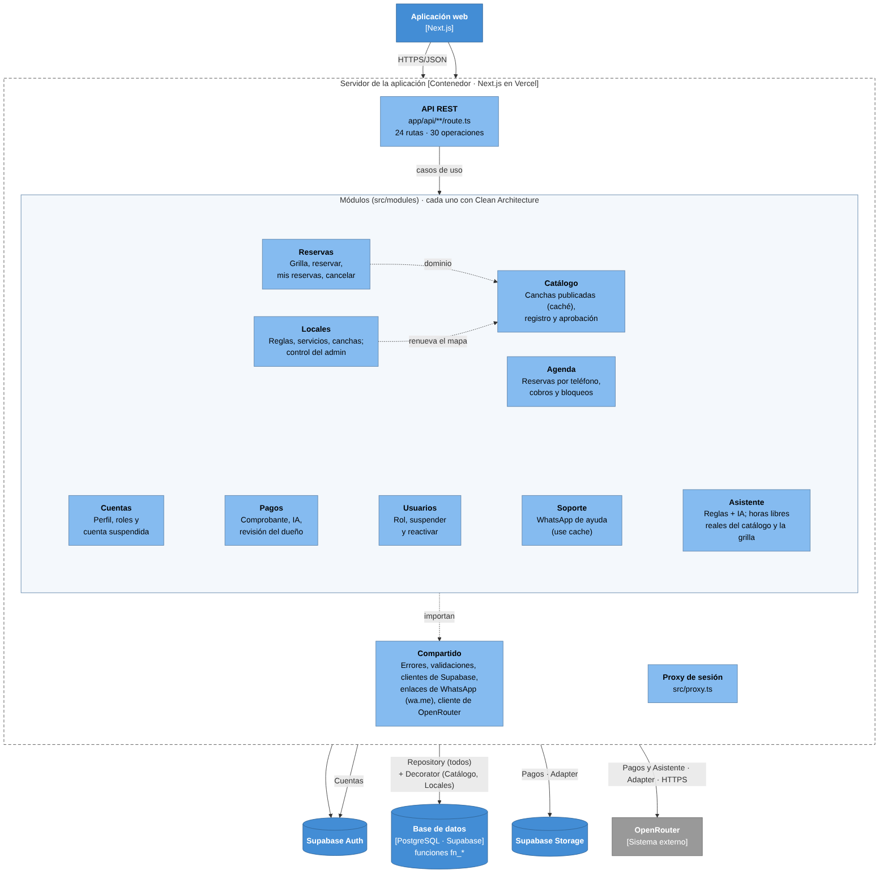

# Nivel 3 · Diagrama de componentes

> **Proyecto:** ReservaYa Ayacucho · **Contenedor detallado:** Servidor de la aplicación (Next.js)  
> **Modelo:** C4 · Nivel 3 de 4 · **Versión:** 2.1 (22/11/2026: módulo Asistente)

---

## 1. Objetivo

Abrir el contenedor **Servidor de la aplicación** del nivel 2 y mostrar sus **componentes**: los módulos del monolito modular, la responsabilidad de cada uno y cómo se relacionan entre sí y con Supabase y OpenRouter.

| Aspecto | Descripción |
|---|---|
| Pregunta que responde | ¿Cómo se divide el servidor por dentro y qué hace cada parte? |
| Audiencia | Arquitectos y desarrolladores |
| Qué es un componente | Un grupo de funcionalidades con una responsabilidad clara, accesible mediante una interfaz. En este proyecto, cada **módulo** de `apps/web/src/modules/` es un componente |
| Nivel anterior | `Nivel2-DiagramadeContenedores.md` |
| Siguiente nivel | `Nivel4-DiagramadeCodigo.md` |

---

## 2. Diagrama

> Archivo editable: `img/fuentes-svg/nivel3-componentes.mmd`

---

## 3. Componentes

| Componente | Responsabilidad | Funcionalidades principales | Carpeta en el código |
|---|---|---|---|
| **API REST** | Punto de entrada HTTP | 24 archivos de rutas (30 operaciones) en `/api`, validación de la entrada, respuestas de error uniformes, cabeceras de caché | `src/app/api/` |
| **Proxy de sesión** | Renovar la sesión y proteger páginas | Redirige al login si no hay sesión en `/mi-cuenta`, `/dueno`, `/admin`, `/reservas` | `src/proxy.ts` |
| **Cuentas** | Identidad y roles | Perfil de quien navega, roles (jugador, dueño, admin), cuenta suspendida con su motivo, destino seguro después del login | `src/modules/cuentas/` |
| **Catálogo** | Locales y canchas | Canchas publicadas para el mapa (con caché), registrar, corregir o quitar canchas en revisión, aprobar o rechazar | `src/modules/catalogo/` |
| **Reservas** | Proceso de reserva | Ficha del local, grilla de horarios, reservar con clave de idempotencia, mis reservas, cancelar | `src/modules/reservas/` |
| **Pagos** | Adelanto por Yape/Plin | Subir la captura, leerla con IA, comparar con lo esperado, revisión del dueño, datos de Yape/Plin del local | `src/modules/pagos/` |
| **Agenda** | Día a día del dueño | Agenda por cancha, reservas por teléfono, cobro en efectivo, "jugó" / "no vino", bloqueos | `src/modules/agenda/` |
| **Locales** | Configuración y control | Reglas de reserva, servicios del local, canchas con horario y precios; locales publicados del admin (asignar dueño, suspender) | `src/modules/locales/` |
| **Usuarios** | Gestión de cuentas (admin) | Buscar cuentas, cambiar entre jugador y dueño, suspender con motivo y reactivar | `src/modules/usuarios/` |
| **Soporte** | Ayuda por WhatsApp | Número de ayuda de la plataforma (con caché) para el botón "Ayuda" | `src/modules/soporte/` |
| **Asistente** | Chat de canchas (RF09) | Entender el mensaje con reglas (y con IA si hace falta, con cupo diario), buscar locales con horas libres reales y enlazarlas a la grilla, responder dudas frecuentes | `src/modules/asistente/` |
| **Compartido** | Lo común a todos | Error de la aplicación con códigos y mensajes, validaciones, clientes de Supabase, traducción de errores, enlaces de WhatsApp, cliente de OpenRouter, límite de pedidos por IP | `src/modules/compartido/` |

---

## 4. Relaciones entre componentes

| Origen | Destino | Descripción | Tipo de comunicación |
|---|---|---|---|
| Aplicación web | API REST | Llama a la API | HTTPS/JSON |
| API REST | Catálogo, Reservas, Pagos, Agenda, Locales, Usuarios, Soporte, Asistente | Invoca los casos de uso | Llamada en memoria |
| Páginas del servidor | Cuentas | Obtienen el perfil y el rol de quien navega | Llamada en memoria |
| Reservas | Catálogo | Usa el dominio del catálogo (nombres de deportes, distritos y servicios) | Importación del dominio |
| Locales | Catálogo | Al cambiar un local, renueva la caché del catálogo del mapa | Llamada en memoria |
| Asistente | Catálogo y Reservas | Lee el catálogo publicado (con su caché), la ficha del local y la grilla de horarios a través de sus casos de uso y lecturas públicas (puerto `FuenteCanchas`) | Llamada en memoria |
| Pagos y Asistente | Compartido | Usan el mismo cliente de OpenRouter (`pedirJSON`) | Importación |
| Todos los módulos | Compartido | Errores, validaciones y clientes de Supabase | Importación |

---

## 5. Relaciones con contenedores y sistemas externos

| Componente | Destino | Descripción | Protocolo | Patrón aplicado |
|---|---|---|---|---|
| Catálogo | Base de datos | `fn_catalogo_canchas`, `fn_proponer_local`, `fn_revisar_local`... | HTTPS (PostgREST) | Repository + Decorator (caché) |
| Reservas | Base de datos | `fn_local_publico`, `fn_disponibilidad_local`, `fn_reservar`, `fn_mis_reservas`, `fn_cancelar_reserva` | HTTPS (PostgREST) | Repository |
| Pagos | Base de datos | `fn_estado_pago`, `fn_registrar_pago`, `fn_revisar_pago`... | HTTPS (PostgREST) | Repository |
| Pagos | Almacenamiento | Sube capturas y crea enlaces firmados | HTTPS/REST | Adapter |
| Pagos | OpenRouter | Lectura del comprobante con modelos de respaldo | HTTPS/REST | Adapter |
| Cuentas | Supabase Auth | Usuario de la sesión y `fn_mi_perfil` | HTTPS | — |
| Agenda | Base de datos | `fn_agenda_local`, `fn_reserva_manual`, `fn_gestionar_reserva`, `fn_bloquear_horario`... | HTTPS (PostgREST) | Repository |
| Locales | Base de datos | `fn_config_local`, `fn_guardar_servicios`, `fn_guardar_cancha`, `fn_locales_admin`... | HTTPS (PostgREST) | Repository + Decorator (renueva la ficha y el mapa) |
| Usuarios | Base de datos | `fn_usuarios_admin`, `fn_cambiar_rol`, `fn_cambiar_estado_usuario` | HTTPS (PostgREST) | Repository |
| Soporte | Base de datos | `fn_ajustes_publicos`, `fn_guardar_ajustes` | HTTPS (PostgREST) | Repository + caché `"use cache"` |
| Asistente | Base de datos | `fn_cupo_asistente`, `fn_config_ia`, `fn_registrar_ia_asistente`, `fn_uso_ia_hoy` | HTTPS (PostgREST) | Repository |
| Asistente | OpenRouter | Interpretar el mensaje (intención y filtros en JSON con esquema), con un modelo de respaldo; solo si las reglas no bastan | HTTPS/REST | Adapter |

> **WhatsApp no aparece como destino:** el servidor no se conecta con WhatsApp. Solo arma enlaces `wa.me` que la persona abre en su celular (ADR-014).

---

## 6. Reglas del monolito modular

| # | Regla | Motivo |
|---|---|---|
| 1 | Todos los componentes se despliegan juntos en el servidor de la aplicación | Es un monolito: un solo proceso y un solo despliegue |
| 2 | La presentación (`app/`) usa los casos de uso y la raíz de composición de cada módulo; nunca escribe SQL | Las reglas quedan en un solo lugar |
| 3 | Un módulo no lee ni escribe las tablas de otro módulo | Mantiene la independencia de los datos de cada módulo |
| 4 | Cada sistema externo se integra detrás de un puerto; si dos módulos lo usan, comparten un solo cliente en `compartido` (OpenRouter: pagos y asistente) | La integración es fácil de reemplazar (por ejemplo, el modelo de IA) y no se duplica |
| 5 | Cada módulo se organiza por dentro con Clean Architecture | Las reglas de negocio no dependen de la tecnología (ver nivel 4) |
