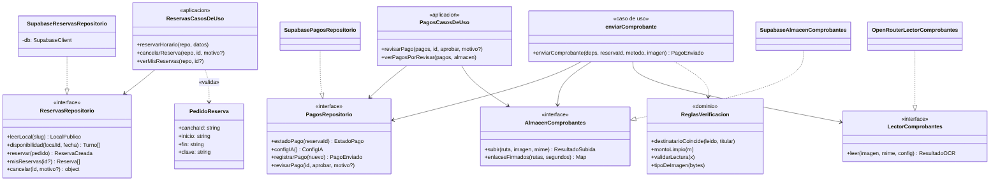

# Nivel 4 · Diagrama de código

> **Proyecto:** ReservaYa Ayacucho · **Módulos detallados:** Reservas y Pagos  
> **Modelo:** C4 · Nivel 4 de 4 · **Notación:** UML · **Versión:** 2.0 (Sprint 2: alineado con el código implementado)

---

## 1. Objetivo

Mostrar **cómo está organizado el código** de los componentes más importantes del nivel 3: sus clases, interfaces y funciones, y cómo colaboran. Se detalla el flujo **Reservar y pagar el adelanto**, que involucra a los módulos **Reservas** y **Pagos**.

| Aspecto | Descripción |
|---|---|
| Pregunta que responde | ¿Qué clases e interfaces existen dentro de un módulo y cómo se relacionan? |
| Audiencia | Desarrolladores |
| Notación | UML (diagrama de clases y diagrama de secuencia) |
| Por qué solo dos módulos | El nivel 4 es opcional en C4 y se dibuja solo para los componentes más complejos. Reservas y Pagos concentran el control de reservas dobles y la validación de pagos |
| Nivel anterior | `Nivel3-Diagrama-de-Componentes.md` |

---

## 2. Diagrama de clases

> Archivo editable: `img/fuentes-svg/nivel4-clases.mmd`

### 2.1 Capas de Clean Architecture

| Capa | Contiene | Regla |
|---|---|---|
| **Presentación** | Rutas `app/api/**/route.ts` | Traduce HTTP a llamadas del caso de uso y viceversa |
| **Aplicación** | Casos de uso (`aplicacion/`) | Coordina los pasos; recibe los puertos por parámetro |
| **Dominio** | Entidades, reglas puras y puertos (`dominio/`) | No importa nada de las otras capas |
| **Infraestructura** | Repositorios, adaptadores y composición (`infraestructura/`) | Implementa los puertos con Supabase u OpenRouter |

### 2.2 Módulo Reservas (`src/modules/reservas/`)

| Elemento | Tipo | Capa | Responsabilidad |
|---|---|---|---|
| `POST /api/reservas` | Ruta | Presentación | Recibe el pedido y responde `201` o el error |
| `reservarHorario`, `cancelarReserva`, `verMisReservas`, `verDisponibilidad`, `verLocal` | Casos de uso | Aplicación | Validan y delegan en el repositorio |
| `validarPedido` | Regla pura | Dominio | Formato del pedido: UUID, fechas y clave de idempotencia |
| `Reserva`, `EstadoReserva`, `Turno`, `LocalPublico` | Entidades | Dominio | Datos de la reserva y sus estados |
| `ReservasRepositorio` | Interfaz (puerto) | Dominio | Contrato para leer y guardar reservas |
| `SupabaseReservasRepositorio` | Repositorio | Infraestructura | Implementa el puerto con `fn_reservar`, `fn_mis_reservas`, etc. |
| `reservasConSesion`, `reservasPublicas` | Composición | Infraestructura | Entregan el repositorio con o sin sesión |

### 2.3 Módulo Pagos (`src/modules/pagos/`)

| Elemento | Tipo | Capa | Responsabilidad |
|---|---|---|---|
| `POST /api/reservas/[id]/pago` | Ruta | Presentación | Recibe la imagen y el método (Yape/Plin) |
| `enviarComprobante` | Caso de uso | Aplicación | Revisa la reserva, sube la captura, la hace leer por la IA y registra el pago |
| `revisarPago`, `verPagosPorRevisar` | Casos de uso | Aplicación | El dueño confirma o rechaza |
| `tipoDeImagen`, `destinatarioCoincide`, `montoLimpio`, `validarLectura` | Reglas puras | Dominio | Revisan la imagen y lo que leyó la IA (nunca se confía a ciegas) |
| `PagosRepositorio`, `AlmacenComprobantes`, `LectorComprobantes` | Interfaces (puertos) | Dominio | Datos, archivos e IA por separado |
| `SupabasePagosRepositorio`, `SupabaseAlmacenComprobantes`, `OpenRouterLectorComprobantes` | Repositorio y adaptadores | Infraestructura | Implementan los puertos |
| `pagosConSesion` | Composición | Infraestructura | Une los puertos con sus implementaciones |

---

## 3. Diagrama de secuencia: reservar y pagar el adelanto

> Archivo editable: `img/fuentes-svg/nivel4-secuencia.mmd`

| Paso | Origen → destino | Acción |
|---|---|---|
| 1 | Jugador → `POST /api/reservas` | Envía cancha, inicio, fin y una clave única por intento |
| 2 | `reservarHorario` → `validarPedido` | Revisa el formato |
| 3 | `SupabaseReservasRepositorio` → `fn_reservar` | Una transacción: precio turno por turno, máximo 2 reservas por pagar, `INSERT` protegido por `EXCLUDE` |
| 4 | Ruta → Jugador | `201 Created`: reserva «Por pagar», apartada 15 minutos |
| 5 | Jugador → `POST /api/reservas/{id}/pago` | Sube la captura de Yape o Plin |
| 6 | `enviarComprobante` → `PagosRepositorio.estadoPago` | ¿La reserva es suya y sigue por pagar? |
| 7 | `enviarComprobante` → `AlmacenComprobantes.subir` | Guarda la imagen con su huella SHA-256 como nombre |
| 8 | `enviarComprobante` → `LectorComprobantes.leer` | OpenRouter lee monto, n.º de operación, fecha y destinatario (con modelos de respaldo) |
| 9 | `enviarComprobante` → `PagosRepositorio.registrarPago` | La base compara con lo esperado (`match`, `amount_mismatch`, `duplicate_operation`...) y la reserva pasa a «Pago en revisión» |
| 10 | Dueño → `POST /api/pagos/{id}/revisar` | Confirma (la reserva queda «Confirmada») o rechaza con motivo (vuelve a «Por pagar») |
| Alt. | Horario tomado | `409 HORARIO_OCUPADO`, aunque dos pedidos lleguen a la vez |
| Alt. | La IA falla o no hay clave | El pago queda para revisión manual; nunca se bloquea |

---

## 4. Patrones y principios que se ven en este nivel

| Elemento del diagrama | Patrón o principio |
|---|---|
| `OpenRouterLectorComprobantes`, `SupabaseAlmacenComprobantes` | Patrón **Adapter** |
| `ReservasRepositorio` / `SupabaseReservasRepositorio`, `PagosRepositorio` / `SupabasePagosRepositorio` | Patrón **Repository** |
| `CatalogoEnCache` (módulo catálogo) | Patrón **Decorator** |
| `enviarComprobante` recibe interfaces, no clases concretas | **Inversión de dependencias** (SOLID) |
| Tres puertos pequeños en Pagos | **Segregación de interfaces** (SOLID) |

> Detalle completo en `03-diseño-de-software/diseño-interno/patrones-de-diseño.md` y `principios-de-diseño.md`.
