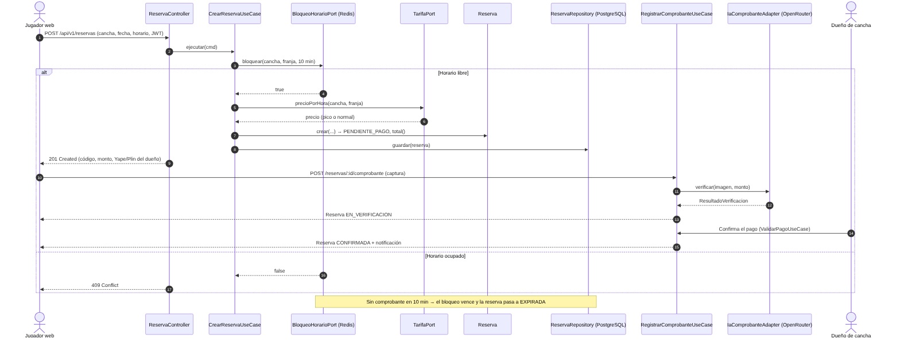

# Nivel 4 · Diagrama de código

> **Proyecto:** ReservaYa Ayacucho · **Módulos detallados:** Reservas y Pagos  
> **Modelo:** C4 · Nivel 4 de 4 · **Notación:** UML · **Versión:** 1.0

---

## 1. Objetivo

Mostrar **cómo está organizado el código** de un componente del nivel 3: sus clases, interfaces y la forma en que colaboran. Se detalla el flujo **Reservar y pagar una cancha**, que involucra a los módulos **Reservas** y **Pagos**, el bloqueo de horarios en Redis y la verificación del comprobante con IA.

| Aspecto | Descripción |
|---|---|
| Pregunta que responde | ¿Qué clases existen dentro de un módulo y cómo se relacionan? |
| Audiencia | Desarrolladores |
| Notación | UML (diagrama de clases y diagrama de secuencia). El modelo C4 recomienda UML para este nivel |
| Por qué solo dos módulos | El nivel 4 es opcional en C4 y se dibuja solo para los componentes más importantes o complejos. Reservas y Pagos concentran el control de reservas dobles y la validación de pagos |
| Nivel anterior | `Nivel3-Diagrama-de-Componentes.md` |

---

## 2. Diagrama de clases

> Archivo editable: `img/fuentes-svg/nivel4-clases.mmd`

### 2.1 Capas de Clean Architecture

| Capa | Contiene | Regla |
|---|---|---|
| **Presentación** | Controladores | Traduce HTTP a llamadas del caso de uso y viceversa |
| **Aplicación** | Casos de uso | Coordina los pasos del proceso; no conoce la tecnología |
| **Dominio** | Entidades, objetos de valor, interfaces | Contiene las reglas del negocio; no importa nada de las otras capas |
| **Infraestructura** | Repositorios y adaptadores | Implementa las interfaces del dominio con una tecnología concreta |

> **Regla de dependencia:** las flechas del código apuntan hacia el dominio. Las clases de infraestructura implementan interfaces del dominio (triángulo hueco); el dominio nunca conoce a la infraestructura.

### 2.2 Clases del módulo Reservas

| Clase | Tipo | Capa | Responsabilidad |
|---|---|---|---|
| `ReservaController` | Controlador | Presentación | Recibe `POST /api/v1/reservas` y responde al jugador |
| `CrearReservaUseCase` | Caso de uso | Aplicación | Bloquea el horario, obtiene el precio, crea la reserva y la guarda |
| `MarcarEnVerificacionUseCase` | Caso de uso (API pública) | Aplicación | Único punto por el que Pagos cambia el estado de una reserva |
| `Reserva` | Entidad | Dominio | Valida la reserva, calcula el total y controla sus estados |
| `FranjaHoraria` | Objeto de valor | Dominio | Fecha, hora de inicio y hora de fin; valida la duración y que no sea un horario pasado |
| `EstadoReserva` | Enumeración | Dominio | PENDIENTE_PAGO, EN_VERIFICACION, CONFIRMADA, RECHAZADA, CANCELADA, EXPIRADA |
| `ReservaRepository` | Interfaz | Dominio | Contrato para guardar y buscar reservas |
| `BloqueoHorarioPort` | Interfaz | Dominio | Contrato para bloquear y liberar un horario |
| `TarifaPort` | Interfaz | Dominio | Contrato para obtener el precio por hora (pico o normal) |
| `PostgresReservaRepository` | Repositorio | Infraestructura | Implementa `ReservaRepository` con PostgreSQL |
| `RedisBloqueoHorarioAdapter` | Adaptador | Infraestructura | Implementa `BloqueoHorarioPort` con Redis (bloqueo con tiempo de expiración) |
| `HorariosTarifaAdapter` | Adaptador | Infraestructura | Implementa `TarifaPort` usando la API pública del módulo Horarios |

### 2.3 Clases del módulo Pagos

| Clase | Tipo | Capa | Responsabilidad |
|---|---|---|---|
| `PagoController` | Controlador | Presentación | Recibe `POST /api/v1/reservas/:id/comprobante` y `PATCH /api/v1/pagos/:id` |
| `RegistrarComprobanteUseCase` | Caso de uso | Aplicación | Guarda la imagen, la verifica con IA y pasa la reserva a EN_VERIFICACION |
| `ValidarPagoUseCase` | Caso de uso | Aplicación | Permite al dueño confirmar o rechazar el pago |
| `ComprobanteStoragePort` | Interfaz | Dominio | Contrato para guardar la imagen del comprobante |
| `VerificadorComprobantePort` | Interfaz | Dominio | Contrato para leer los datos del comprobante (monto, fecha, número de operación) |
| `ResultadoVerificacion` | DTO | Dominio | Indica si los datos leídos coinciden con la reserva o el motivo de la diferencia |
| `SupabaseStorageAdapter` | Adaptador | Infraestructura | Implementa `ComprobanteStoragePort` con Supabase Storage |
| `IaComprobanteAdapter` | Adaptador | Infraestructura | Implementa `VerificadorComprobantePort` usando la API pública del módulo Asistente IA (OpenRouter) |

### 2.4 Notación UML utilizada

| Símbolo | Significado | Ejemplo |
|---|---|---|
| Línea continua con flecha abierta | Asociación: la clase tiene una referencia a la otra | `CrearReservaUseCase` → `ReservaRepository` |
| Línea discontinua con flecha abierta | Dependencia: la usa o la crea | `CrearReservaUseCase` «crea» `Reserva` |
| Línea discontinua con triángulo hueco | Realización: implementa una interfaz | `PostgresReservaRepository` ▷ `ReservaRepository` |
| Rombo relleno | Composición: la parte no existe sin el todo | `Reserva` ◆ `FranjaHoraria` |
| Nombre en cursiva con «interface» | Interfaz | `BloqueoHorarioPort` |
| `-` y `+` | Atributo o método privado y público | `- estado`, `+ total()` |

---

## 3. Diagrama de secuencia: reservar y pagar una cancha

> Archivo editable: `img/fuentes-svg/nivel4-secuencia.mmd`

| Paso | Origen → destino | Acción |
|---|---|---|
| 1 | Jugador web → `ReservaController` | Envía `POST /api/v1/reservas` con la cancha, la fecha, el horario y el JWT |
| 2 | `ReservaController` → `CrearReservaUseCase` | Ejecuta el caso de uso |
| 3 | `CrearReservaUseCase` → `BloqueoHorarioPort` | Bloquea el horario por 10 minutos en Redis |
| 4 | `CrearReservaUseCase` → `TarifaPort` | Obtiene el precio por hora (hora pico o normal) |
| 5 | `CrearReservaUseCase` → `Reserva` | Crea la reserva (estado PENDIENTE_PAGO) y calcula el total |
| 6 | `CrearReservaUseCase` → `ReservaRepository` | Guarda la reserva en PostgreSQL |
| 7 | `ReservaController` → Jugador web | Responde `201 Created` con el código de reserva, el monto y el número Yape/Plin del dueño |
| 8 | Jugador web → `PagoController` → `RegistrarComprobanteUseCase` | Sube la captura del comprobante |
| 9 | `SupabaseStorageAdapter` → Almacenamiento | Guarda la imagen |
| 10 | `IaComprobanteAdapter` → OpenRouter | Lee el monto, la fecha y el número de operación; la reserva pasa a EN_VERIFICACION |
| 11 | Dueño de cancha → `ValidarPagoUseCase` | Confirma el pago; la reserva pasa a CONFIRMADA y se notifica al jugador |
| 12 | Alternativa | Si el horario ya está bloqueado por otro jugador, no se crea la reserva y se responde `409 Conflict` |
| 13 | Alternativa | Si no se sube el comprobante en 10 minutos, el bloqueo vence y la reserva pasa a EXPIRADA |

---

## 4. Patrones y principios que se ven en este nivel

| Elemento del diagrama | Patrón o principio |
|---|---|
| `RedisBloqueoHorarioAdapter`, `SupabaseStorageAdapter`, `IaComprobanteAdapter` | Patrón **Adapter** |
| `ReservaRepository` y `PostgresReservaRepository` | Patrón **Repository** |
| El caso de uso recibe interfaces, no clases concretas | Principio de **inversión de dependencias** (SOLID) |
| Una clase por responsabilidad (controlador, caso de uso, entidad, repositorio) | Principio de **responsabilidad única** (SOLID) |
| Pagos cambia el estado de la reserva solo mediante `MarcarEnVerificacionUseCase` | Regla del **monolito modular**: comunicación por la API pública del módulo |

> Detalle completo en `03-diseño-de-software/diseño-interno/patrones-de-diseño.md` y `principios-de-diseño.md`.

---
