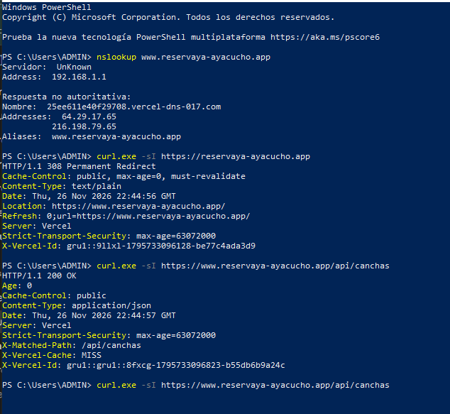

# Despliegue

> **Proyecto:** ReservaYa Ayacucho · **Entornos:** desarrollo local y producción · **Versión:** 2.2 (26/11/2026: dominio propio y copias de seguridad)

---

## 1. Servicios que se usan

| Servicio | Para qué | Estado |
|---|---|---|
| **GitHub** | Repositorio; cada push a `main` despliega solo | En uso |
| **Vercel** | Aplicación Next.js (web + API), CDN y funciones en São Paulo (`gru1`) | En uso: https://www.reservaya-ayacucho.app (también https://reservaya-ayacucho.vercel.app) |
| **Name.com** | Dominio `reservaya-ayacucho.app` y su DNS (gratis 1 año con el GitHub Student Pack) | En uso desde el 26/11/2026 (ADR-016) |
| **Supabase** | PostgreSQL, Auth y Storage (bucket privado `comprobantes`), región São Paulo | En uso |
| **OpenRouter** | Modelos de IA gratuitos para leer comprobantes y para el asistente | En uso |
| **OpenStreetMap** | Teselas del mapa (sin clave) | En uso |
| **GitHub Actions** | Lint, tipos, pruebas con cobertura (Jest), build y E2E en cada push (`ci.yml`); copia de seguridad semanal cifrada de la base (`respaldo.yml`) | En uso |
| **Upstash** | Redis para la caché compartida | Pospuesto (ADR-013) |
| **Cloudflare** | DNS y CDN delante de Vercel | Descartado: Vercel ya es la CDN y no recomienda otro proxy delante (ADR-016) |

---

## 2. Variables de entorno

### Vercel (y `apps/web/.env.local` en desarrollo)

| Variable | Descripción | Visible en el navegador |
|---|---|---|
| `NEXT_PUBLIC_SUPABASE_URL` | URL del proyecto de Supabase | Sí (es pública) |
| `NEXT_PUBLIC_SUPABASE_PUBLISHABLE_KEY` | Clave publicable de Supabase (lo que protege los datos es RLS) | Sí (es pública) |
| `OPENROUTER_API_KEY` | Clave de OpenRouter, tipo **Secret**, solo Production | **No** |

> Nunca se usan en la web la clave `secret` ni `service_role` de Supabase.

---

## 3. Pasos de despliegue

| Paso | Acción |
|---|---|
| 1 | Crear el proyecto en Supabase y ejecutar en el SQL Editor el esquema inicial y las migraciones de `database/migrations/` en orden (004 → 013) |
| 2 | En Supabase Auth → URL Configuration: Site URL `https://www.reservaya-ayacucho.app` y Redirect URLs `http://localhost:3000/**`, `https://reservaya-ayacucho.vercel.app/**` y `https://www.reservaya-ayacucho.app/**` |
| 3 | Crear el proyecto en Vercel con **Root Directory** `apps/web` y cargar las variables de entorno |
| 4 | Hacer push a `main`: Vercel compila (`next build`) y publica |
| 5 | **Antes** de subir código que use funciones nuevas de la base, ejecutar su migración en Supabase (si no, la web muestra «Ejecuta las migraciones») |
| 6 | Conectar el dominio propio (sección 4) |

---

## 4. Dominio, DNS y CDN

| Pieza | Configuración |
|---|---|
| Dominio | `reservaya-ayacucho.app`, registrado en **Name.com** con el GitHub Student Pack el 26/11/2026. Vence el 26/11/2027; la renovación automática está apagada y la cuenta no guarda tarjeta (costo cero) |
| Dirección principal | `https://www.reservaya-ayacucho.app`. `https://reservaya-ayacucho.app` redirige con **308** a `www` (opción recomendada por Vercel) |
| DNS (en Name.com) | `A` · `@` → `216.198.79.1` y `CNAME` · `www` → `25ee611e40f29708.vercel-dns-017.com` (valores que muestra Vercel en Settings → Domains). Sin otros registros A, AAAA o CNAME |
| HTTPS | Certificado automático de Vercel. `.app` está en la lista HSTS de los navegadores: solo abre con HTTPS |
| CDN | Red de Vercel. Catálogo `s-maxage=60, stale-while-revalidate=300`; grilla `s-maxage=5, stale-while-revalidate=15`; Swagger `s-maxage=3600`; archivos estáticos con hash; respuestas privadas `private, no-store` |
| Por qué no Cloudflare | Vercel ya es la CDN y recomienda no poner otro proxy delante (doble caché y fallas al renovar el certificado). Cloudflare solo como DNS no aportaba nada (ADR-016) |

**Cómo comprobarlo (PowerShell):**

| Comando | Resultado esperado |
|---|---|
| `nslookup www.reservaya-ayacucho.app` | Responde con el nombre `*.vercel-dns-017.com` y sus direcciones |
| `curl.exe -sI https://reservaya-ayacucho.app` | `HTTP/1.1 308` y `location: https://www.reservaya-ayacucho.app/` |
| `curl.exe -sI https://www.reservaya-ayacucho.app/api/canchas` (dos veces) | `x-vercel-cache: MISS` (o `STALE`) la primera vez y `HIT` la segunda: la respuesta salió de la CDN sin tocar el servidor ni la base |


**Resultado real (26/11/2026, desde Ayacucho):**

```
PS> nslookup www.reservaya-ayacucho.app
Nombre:    25ee611e40f29708.vercel-dns-017.com
Addresses: 64.29.17.65
           216.198.79.65
Aliases:   www.reservaya-ayacucho.app

PS> curl.exe -sI https://reservaya-ayacucho.app
HTTP/1.1 308 Permanent Redirect
Location: https://www.reservaya-ayacucho.app/
Server: Vercel
Strict-Transport-Security: max-age=63072000
X-Vercel-Id: gru1::9llx1-1795733096128-be77c4ada3d9

PS> curl.exe -sI https://www.reservaya-ayacucho.app/api/canchas      (1.ª vez)
HTTP/1.1 200 OK
Age: 0
X-Vercel-Cache: MISS
X-Vercel-Id: gru1::gru1::8fxcg-1795733096823-b55db6b9a24c

PS> curl.exe -sI https://www.reservaya-ayacucho.app/api/canchas      (88 s después)
HTTP/1.1 200 OK
Age: 88
X-Vercel-Cache: STALE

PS> curl.exe -sI https://www.reservaya-ayacucho.app/api/canchas      (enseguida)
HTTP/1.1 200 OK
Age: 2
X-Vercel-Cache: HIT
X-Vercel-Id: gru1::gru1::kmb5c-1795733251808-353e2289d36c
```

| Qué muestra | Interpretación |
|---|---|
| `nslookup` | El DNS de Name.com lleva `www` a la red de Vercel |
| `308` + `Strict-Transport-Security` | El dominio sin `www` redirige al principal y el navegador queda obligado a usar HTTPS por 2 años |
| `MISS` → `STALE` → `HIT` | 1.ª vez la respuesta la arma el servidor; pasados los 60 s la CDN entrega igual la copia guardada (`stale-while-revalidate`) y la renueva por detrás; después responde la copia nueva (`HIT`, `Age: 2`) sin tocar el servidor ni la base |
| `gru1` en `X-Vercel-Id` | La respuesta salió del punto de la CDN y de las funciones en São Paulo, el más cercano a Ayacucho |
| `Cache-Control: public` | Vercel quita `s-maxage` y `stale-while-revalidate` de la respuesta al navegador porque esas reglas son para su CDN |



---

## 5. Copias de seguridad

Supabase gratis no guarda copias de seguridad. El workflow `.github/workflows/respaldo.yml` (ADR-017, spec 015) hace una **cada domingo a las 03:17 de Ayacucho** y también cuando se pide a mano (Actions → «Respaldo de la base de datos» → **Run workflow**).

| Paso del workflow | Qué hace |
|---|---|
| 1 | Revisa que existan los secretos y que la cadena sea la del Session pooler |
| 2 | `supabase db dump`: `roles.sql`, `schema.sql` y `data.sql` (incluye `auth.users`) |
| 3 | Escribe en el resumen de la ejecución cuántas filas tiene cada tabla (sin datos) |
| 4 | Restaura el respaldo en una base vacía; si falla, la ejecución sale en rojo y GitHub avisa por correo |
| 5 | Lo cifra con GPG AES-256 y borra los archivos sin cifrar |
| 6 | Guarda `reservaya-respaldo-AAAA-MM-DD.tar.gz.gpg` como artifact por 90 días (unas 13 copias) |

**Secretos del repositorio** (GitHub → Settings → Secrets and variables → Actions):

| Secreto | Valor |
|---|---|
| `SUPABASE_DB_URL` | Supabase → **Connect** → **Session pooler** → URI, con la contraseña de la base en lugar de `[YOUR-PASSWORD]` (`postgresql://postgres.<ref>:…@aws-…-sa-east-1.pooler.supabase.com:5432/postgres`). La conexión directa no sirve: es IPv6 y GitHub solo usa IPv4 |
| `BACKUP_PASSPHRASE` | Frase de 16 caracteres o más. **Se guarda también fuera de GitHub**: GitHub no deja volver a leer un secreto, y sin la frase el respaldo no se puede abrir |

**Restaurar** (en Git Bash, que ya trae `gpg`; para el último paso hace falta `psql`):

```bash
# 1. Descargar el artifact de la ejecución (Actions → ejecución → Artifacts) y descomprimir el .zip
# 2. Descifrar (pide la frase) y desempaquetar
gpg --decrypt --output respaldo.tar.gz reservaya-respaldo-*.tar.gz.gpg
tar -xzf respaldo.tar.gz
# 3. Cargarlo en un proyecto NUEVO de Supabase (nunca encima de producción)
psql --single-transaction --variable ON_ERROR_STOP=1 \
  --file roles.sql --file schema.sql \
  --command 'SET session_replication_role = replica' \
  --file data.sql --dbname "$URL_DEL_PROYECTO_NUEVO"
```

Después se ejecutan en el proyecto nuevo las migraciones posteriores al respaldo (si las hubiera), se cambian las variables `NEXT_PUBLIC_SUPABASE_URL` y `NEXT_PUBLIC_SUPABASE_PUBLISHABLE_KEY` en Vercel y se vuelve a publicar.

**Qué no cubre:** las capturas del bucket `comprobantes` (Storage) ni la configuración del panel de Supabase (Auth → URL Configuration, plantillas de correo). Los pagos ya revisados quedan registrados en la base.

---

## 6. Monitoreo

| Qué | Dónde |
|---|---|
| Errores y registros del servidor | Vercel → proyecto → Logs |
| Uso y costo de la IA | Tabla `ai_requests` y panel de OpenRouter |
| Base de datos | Supabase → Reports |
| Copias de seguridad | GitHub → Actions → «Respaldo de la base de datos» (resumen con filas por tabla; correo de GitHub si falla) |
