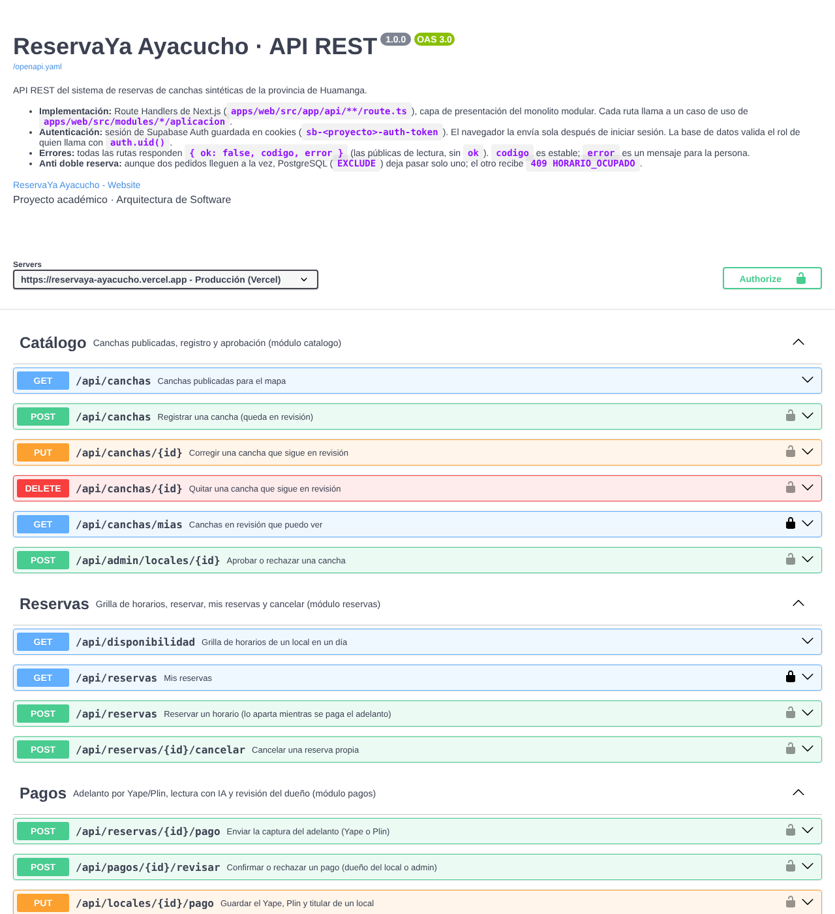

# Pruebas automatizadas

> **Proyecto:** ReservaYa Ayacucho · **Herramientas:** Jest 29 (con `next/jest`), Playwright, GitHub Actions · **Versión:** 1.2 (21/11/2026)  
> **Specs:** `specs/007-api-documentada-y-pruebas/spec.md`, `specs/011-pruebas-e2e/spec.md`, `specs/012-servicios-usuarios-whatsapp/spec.md`

---

## 1. Objetivo

Comprobar automáticamente que las reglas de negocio y la API funcionan, cada vez que cambia el código, y medir qué parte del código está cubierta por las pruebas.

---

## 2. Cómo ejecutarlas

En la carpeta `apps/web`:

| Comando | Qué hace |
|---|---|
| `npm test` | Ejecuta todas las pruebas |
| `npm run test:cobertura` | Ejecuta las pruebas y genera el reporte de cobertura en `coverage/` (abrir `coverage/lcov-report/index.html`) |
| `npm run lint` | Revisa el estilo del código |
| `npm run typecheck` | Revisa los tipos de TypeScript |
| `npm run e2e` | Pruebas E2E con un navegador real (ver [`03-pruebas-e2e.md`](03-pruebas-e2e.md)) |

---

## 3. Qué se prueba

Las pruebas siguen las capas de Clean Architecture. Como los casos de uso reciben sus puertos por parámetro, se prueban con **implementaciones falsas** en memoria: no usan la base real, Storage ni OpenRouter.

| Tipo | Archivo | Qué comprueba | Pruebas |
|---|---|---|---|
| Unitaria · dominio | `unitarias/pagos/verificar.test.ts` | Revisión de lo que lee la IA: nombres abreviados, fechas en hora de Perú, montos, n.º de operación, JSON de la IA | 19 |
| Unitaria · dominio | `unitarias/pagos/imagen-y-textos.test.ts` | Tipo real de la imagen (JPG, PNG, WEBP) y textos para el jugador | 5 |
| Unitaria · dominio + aplicación | `unitarias/reservas/reservas.test.ts` | `validarPedido`, estados, fechas en hora de Ayacucho y casos de uso de reservas | 19 |
| Unitaria · dominio + aplicación | `unitarias/catalogo/catalogo.test.ts` | Reglas de la cancha, distancias, validación, caché del catálogo (Decorator) y casos de uso | 17 |
| Unitaria · dominio | `unitarias/catalogo/servicios.test.ts` | Servicios del local: lista igual a la tabla `amenities`, orden y filtro del mapa | 4 |
| Unitaria · dominio + aplicación | `unitarias/agenda/agenda.test.ts` | Agenda del dueño: saldo, acciones posibles, filas por cancha, turnos libres, resumen del día, WhatsApp, validaciones y casos de uso | 30 |
| Unitaria · dominio + aplicación | `unitarias/locales/locales.test.ts` | Configuración del local: horas de 30 min, día válido, resumen del horario, servicios, validaciones y casos de uso del dueño y del admin | 24 |
| Unitaria · dominio + aplicación + infraestructura | `unitarias/usuarios/usuarios.test.ts` | Gestión de usuarios (RF08): búsqueda, validación de pedidos, fechas, casos de uso, repositorio y traducción de errores | 18 |
| Unitaria · dominio + aplicación + infraestructura | `unitarias/soporte/soporte.test.ts` | WhatsApp de ayuda (RF15): validación del celular, guardado con renovación de caché y lectura `"use cache"` | 6 |
| Unitaria · aplicación | `unitarias/pagos/enviar-comprobante.test.ts` | Caso de uso principal de pagos con puertos falsos: cada error y el camino feliz | 7 |
| Unitaria · aplicación | `unitarias/pagos/pagos-casos-de-uso.test.ts` | Revisión del dueño, enlaces firmados, datos de Yape/Plin | 6 |
| Unitaria · compartido | `unitarias/compartido/errores.test.ts` | Códigos de error y traducción de errores de Supabase | 14 |
| Unitaria · compartido | `unitarias/compartido/whatsapp.test.ts` | Enlaces `wa.me` con el mensaje ya escrito (RF15) | 4 |
| Unitaria · infraestructura | `unitarias/infraestructura/repositorios.test.ts` | Qué función de PostgreSQL llama cada repositorio, con qué parámetros y cómo convierte filas y errores | 19 |
| Unitaria · infraestructura | `unitarias/infraestructura/openrouter-lector.test.ts` | Adaptador de IA: modelo de respaldo, demora, modelos gratis y de pago | 6 |
| Unitaria · infraestructura | `unitarias/infraestructura/local-publico.test.ts` | Ficha del local con la caché de Next.js | 2 |
| Unitaria · infraestructura | `unitarias/infraestructura/agenda-repositorio.test.ts` | Repositorio de la agenda, mapeo y errores; motivo de cancelación del local | 15 |
| Unitaria · infraestructura | `unitarias/infraestructura/locales-repositorio.test.ts` | Repositorio de locales (incluye servicios), renovación de cachés (Decorator) y llamadas a la API desde el navegador | 24 |
| Integración · API | `integracion/api.test.ts` | Las 23 rutas `/api` reales (presentación → caso de uso → repositorio) con Supabase falso: códigos HTTP, cabeceras de caché, errores | 61 |
| Integración · contrato | `integracion/openapi.test.ts` | `openapi.yaml` describe exactamente las rutas del código | 3 |
| **Total** | **20 archivos** | | **303** |

---

## 4. Resultados

Ejecución del 21/11/2026: **303 de 303 pruebas pasan** en aproximadamente 3 segundos.

### Cobertura

| Métrica | % | Cubiertas |
|---|---|---|
| Líneas | **99,16 %** | 1309 / 1320 |
| Sentencias | 96,61 % | 1626 / 1683 |
| Funciones | 96,27 % | 388 / 403 |
| Ramas | 92,39 % | 777 / 841 |

Mínimo exigido en `jest.config.mjs`: 80 % de líneas, sentencias y funciones y 70 % de ramas. Si la cobertura baja de eso, la prueba falla.

**Qué se mide:** los módulos (`src/modules/**`) y las rutas de la API (`src/app/api/**/route.ts`). No se miden los componentes visuales de React ni los clientes de conexión de Supabase: esos los recorren las pruebas E2E ([`03-pruebas-e2e.md`](03-pruebas-e2e.md)).

---

## 5. Integración continua (GitHub Actions)

El archivo `.github/workflows/ci.yml` se ejecuta en cada push y pull request a `main`:

| Paso | Comando |
|---|---|
| 1. Instalar dependencias | `npm ci` |
| 2. Estilo | `npm run lint` |
| 3. Tipos | `npm run typecheck` |
| 4. Pruebas con cobertura | `npm run test:cobertura -- --ci` |
| 5. Resumen de cobertura | Tabla en la página de la ejecución |
| 6. Reporte de cobertura | Artefacto `reporte-cobertura` (30 días) |
| 7. Compilación | `npm run build` |
| 8. Pruebas E2E (trabajo aparte, si 1–7 pasan) | PostgreSQL 16 + `npm run e2e:base` + `npm run build` + `npm run e2e`; informe, capturas y videos como artefactos `informe-e2e` y `evidencias-e2e` |

Para ver los resultados: GitHub → pestaña **Actions** → ejecución del commit. Si un paso falla, el commit aparece con una ✗ roja.

---

## 6. Documentación de la API

- Especificación: `apps/web/public/openapi.yaml` (OpenAPI 3.0.3, validada con Redocly CLI).
- Página interactiva: **`/api-docs`** (Swagger UI).

---

## 7. Pruebas de carga y de calidad

Las pruebas con k6 de los escenarios EQ-01, EQ-02 y EQ-04 y el análisis de la base de datos y la caché están en [`02-pruebas-de-carga-y-analisis-bd.md`](02-pruebas-de-carga-y-analisis-bd.md).
