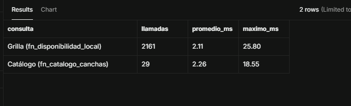
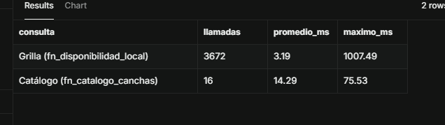
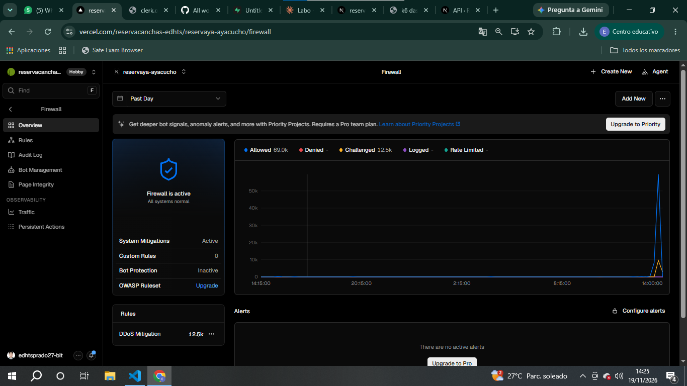

# Pruebas de carga, de calidad y análisis de la base de datos

> **Proyecto:** ReservaYa Ayacucho · **Herramientas:** k6 v2.4.0, Supabase (PostgreSQL, `pg_stat_statements`), Vercel Firewall · **Versión:** 1.0 (Sprint 2)  
> **Spec:** `specs/008-pruebas-de-calidad/spec.md` · **Scripts:** `pruebas-carga/` · **Consultas:** `database/analisis/analisis-bd.sql`  
> **Fecha de ejecución:** 19/11/2026, contra la web publicada https://reservaya-ayacucho.vercel.app

---

## 1. Objetivo

Comprobar con pruebas, sobre el sistema publicado, si la arquitectura cumple los escenarios de calidad del documento `01-analisis-de-sistema/08-escenarios-atributos-calidad.md`, y analizar cómo se comportan la base de datos y la estrategia de caché (ADR-004) bajo carga.

## 2. Entorno de la prueba

| Elemento | Detalle |
|---|---|
| Sistema probado | Producción: Vercel (plan Hobby, funciones en São Paulo `gru1`) + Supabase (plan gratuito, São Paulo) |
| Generador de carga | Una PC con Windows en Ayacucho, conexión doméstica, k6 v2.4.0 |
| Datos | 6 locales publicados (5 «Demo» + 1 de prueba) con sus canchas, horarios y tarifas |
| Comportamiento simulado | Cada usuario virtual abre el mapa (`GET /api/canchas`), mira 1–3 s, abre la grilla de un local y un día al azar de la semana (`GET /api/disponibilidad`) y mira 5–10 s antes de repetir |

---

## 3. EQ-01 · Rendimiento

**Medida:** el 95 % de las consultas responde en ≤ 1,5 s, con menos del 1 % de errores, con 100 usuarios simultáneos.

### 3.1 Resultados

| Perfil | Usuarios | Duración | Pedidos | Catálogo p95 | Grilla p95 | Errores | ¿Cumple? |
|---|---|---|---|---|---|---|---|
| `humo` | 5 | 35 s | 35 | 283 ms | 689 ms | 0 % | ✔ |
| `base` (con CDN) | 100 | 4 min | ≈ 4 390 (2 196 visitas) | ver `resultados/eq01-base.html` | ver `resultados/eq01-base.html` | 1 pedido (corte de red del cliente) | ✔ |
| `sin-cdn` | 100 | 4 min | 4 323 | **171 ms** | **494 ms** | **0,02 %** (1 de 4 323) | ✔ |
| `progresivo` | 100 → 2 000 | 12 min | 71 675 | 26,7 s | 24,5 s | 16,9 % | ✘ (ver 3.3) |

Detalle del perfil `sin-cdn` (el caso más exigente con 100 usuarios, porque cada pedido salta el CDN y llega al servidor):

| Métrica | Catálogo | Grilla |
|---|---|---|
| Promedio | 139 ms | 296 ms |
| Mediana | 122 ms | 278 ms |
| p90 | 148 ms | 331 ms |
| p95 | 171 ms | 494 ms |
| Pedidos / errores | 2 161 / 1 | 2 161 / 0 |

**Conclusión:** con 100 usuarios simultáneos **EQ-01 se cumple con amplio margen**, incluso sin CDN: el p95 más alto (494 ms) es la tercera parte del límite. El único error en cada prueba fue un corte de la conexión doméstica que generaba la carga (`wsarecv` en `192.168.1.4`), no una respuesta de error del sistema.

### 3.2 La caché medida en la base de datos

Antes de cada prueba se reiniciaron los contadores de PostgreSQL (`pg_stat_statements_reset()`) y al terminar se contaron las consultas que llegaron de verdad a la base (sección 7 de `analisis-bd.sql`):

| Prueba | Endpoint | Pedidos de k6 | Consultas en la base | Absorbido por la caché | Tiempo en la base (promedio) |
|---|---|---|---|---|---|
| `sin-cdn` (100 usuarios) | Catálogo | 2 161 | **29** | **98,7 %** (memoria 30 s) | 2,26 ms |
| `sin-cdn` (100 usuarios) | Grilla | 2 161 | 2 161 | 0 % (sin CDN, a propósito) | 2,11 ms |
| `progresivo` (2 000 usuarios) | Catálogo | 36 066 | **16** | **99,96 %** (CDN 60 s + memoria 30 s) | 14,29 ms |
| `progresivo` (2 000 usuarios) | Grilla | 35 608 | **3 672** | **89,7 %** (CDN 5 s) | 3,19 ms |

Lo que muestran estos números:

1. **Cada capa de caché hace su parte.** Sin CDN, la caché en memoria del servidor (`CatalogoEnCache`, patrón Decorator) evitó el 98,7 % de las consultas del catálogo. Con CDN, de 59 568 respuestas correctas 59 509 salieron de Vercel sin tocar el servidor (`X-Vercel-Cache`: 54 692 HIT y 4 817 STALE; solo 59 MISS).
2. **La carga de la base no depende de cuántos usuarios hay, sino de cuántas combinaciones distintas se piden y del tiempo de la caché.** La grilla tiene 42 combinaciones (6 locales × 7 días) y se renueva cada 5 s: con 2 000 usuarios llegaron 3 672 consultas en 12 minutos (≈ 5 por segundo), cuando k6 hizo 35 608 pedidos.
3. **La base de datos no es el cuello de botella:** respondió en 2–3 ms en promedio, con 100 y con 2 000 usuarios. Casi todo el tiempo que mide k6 es el viaje por internet (Ayacucho → Vercel → Supabase).
4. **El tiempo corto de la grilla (5 s) es intencional:** los horarios deben verse casi en vivo. Aunque la caché mostrara un horario ya tomado, la base impide la doble reserva (ver EQ-02).

### 3.3 Prueba progresiva hasta 2 000 usuarios

| Métrica | Valor |
|---|---|
| Pedidos | 71 675 (97 por segundo en promedio) |
| Respuestas correctas | 59 569: mediana **111 ms**, p90 198 ms, p95 **1,09 s** |
| Pedidos sin respuesta | 12 106 (16,9 %): tiempo agotado (60 s) o conexión cortada |
| Firewall de Vercel | Allowed 69,0 mil · **Challenged 12,5 mil por la regla «DDoS Mitigation»** |

**Qué pasó:** al subir la carga desde **una sola IP**, la protección automática anti-DDoS de Vercel interpretó el tráfico como un ataque y empezó a exigir una verificación de navegador (*challenge*). k6 no es un navegador y no puede resolverla, por eso esos pedidos quedaron sin respuesta. El número de pedidos «Challenged» en Vercel (12,5 mil) coincide con los pedidos fallidos en k6 (12 106).

Evidencias de que **el sistema no se saturó**:

- Las respuestas que sí llegaron siguieron siendo rápidas (mediana 111 ms, p95 1,09 s, dentro del límite de EQ-01).
- La base de datos respondió en 3,2 ms en promedio durante toda la prueba.
- Mientras k6 recibía `403` desde la IP de la prueba, la web cargaba normal desde un celular con datos móviles: solo se frenaba a esa IP.
- Minutos después, desde la misma IP, el catálogo volvió a responder `200` y las pruebas EQ-02 y EQ-04 corrieron sin errores.

**Conclusión:** con 2 000 usuarios desde una sola IP no se puede medir el límite del sistema, porque antes actúa la protección de la plataforma. Eso también es un resultado de calidad: el sistema se defiende de una carga anómala sin caerse para los demás usuarios, lo que favorece la disponibilidad (EQ-03). Para medir el límite real haría falta repartir la carga entre muchas IP (por ejemplo, Grafana Cloud k6), lo que queda como trabajo futuro.

---

## 4. EQ-02 · Consistencia: reservas simultáneas

**Medida:** con 50 pedidos simultáneos por el mismo horario se crea exactamente una reserva y los demás reciben `409 Conflict`.

**Cómo se probó** (`eq02-concurrencia.js`): 5 cuentas de jugador de prueba (`k6.jugador1…5@reservaya.test`), 50 usuarios virtuales que esperan la misma hora exacta y envían `POST /api/reservas` por el mismo horario (dentro de ~25 días), cada uno con su propia clave de idempotencia. Al final, k6 revisa la grilla y cancela la reserva ganadora.

| Resultado | Esperado | Obtenido |
|---|---|---|
| Reservas creadas (`201`) | 1 | **1** ✔ |
| Rechazos `409 HORARIO_OCUPADO` | 49 | **49** ✔ |
| Otras respuestas o errores | 0 | **0** ✔ |
| Tiempo de respuesta | — | mediana 1,51 s, máximo 2,49 s |

**Conclusión: EQ-02 se cumple.** La garantía es la restricción `EXCLUDE USING gist (court_id WITH =, period WITH &&)` de `bookings` (ADR-011). Los tiempos de 1,5–2,5 s son esperables: `fn_reservar` toma un candado por persona (`pg_advisory_xact_lock`), así que los 10 pedidos de cada cuenta se atienden uno tras otro, y entre cuentas distintas compiten en el `EXCLUDE`. En el uso real una persona hace un solo pedido.

---

## 5. EQ-04 · Seguridad: operaciones protegidas

**Medida:** se rechaza el 100 % de los intentos no autorizados y ninguna respuesta expone datos sensibles.

| Intento | Sin sesión | Como jugador |
|---|---|---|
| Registrar una cancha | `401 SIN_SESION` | `403 SOLO_DUENOS` |
| Corregir una cancha publicada | `401 SIN_SESION` | `403 SOLO_DUENOS` |
| Quitar una cancha publicada | `401 SIN_SESION` | `403 SOLO_DUENOS` |
| Aprobar o rechazar un local | `401 SIN_SESION` | `403 SOLO_ADMIN` |
| Cambiar el Yape de un local ajeno | `401 SIN_SESION` | `403 LOCAL_AJENO` |
| Confirmar un pago ajeno | `401 SIN_SESION` | `404 PAGO_NO_ENCONTRADO` |
| Cancelar una reserva ajena | `401 SIN_SESION` | `404 RESERVA_NO_ENCONTRADA` |
| Pagar una reserva ajena | `401 SIN_SESION` | `404 RESERVA_NO_ENCONTRADA` |

| Verificación | Resultado |
|---|---|
| Intentos aceptados | **0 de 16** ✔ |
| Respuestas con datos sensibles (tokens, rutas de comprobantes, números de Yape) | **0** ✔ |
| «Mis reservas» sin sesión | Lista vacía ✔ |
| Catálogo antes / después | 6 / 6 canchas; el local atacado sigue publicado ✔ |

**Conclusión: EQ-04 se cumple.** Los rechazos vienen de la base de datos (funciones `SECURITY DEFINER` que validan `auth.uid()` y el rol, ADR-010), no solo de la web. Para pagos y reservas ajenos se responde `404` en lugar de `403`, así nadie puede averiguar si un identificador existe.

---

## 6. Análisis de la base de datos

| Aspecto | Diseño | Lo que se observó |
|---|---|---|
| Doble reserva | `EXCLUDE USING gist` (`bookings_no_overlap`) sobre `court_id` y `period`, solo para reservas activas | 50 pedidos simultáneos → 1 reserva (EQ-02) |
| Consulta más frecuente: «¿este horario está ocupado?» | Usa el mismo predicado que el `EXCLUDE` para aprovechar su índice GiST | Con pocas filas es esperable que PostgreSQL lea la tabla completa (es más barato); la sección 5 de `analisis-bd.sql` fuerza el índice para mostrar que la consulta lo usa cuando la tabla crezca |
| Límite de 2 reservas por pagar | Índice `ix_bookings_jugador_estado (player_id, status, hold_expires_at)` | Se revisa en cada reserva sin leer toda la tabla |
| Tiempo de las funciones | `fn_catalogo_canchas` y `fn_disponibilidad_local` | 2–3 ms en promedio; 14 ms el catálogo con 2 000 usuarios |
| Acceso a datos | Tablas sensibles cerradas a la API (`REVOKE`, RLS); todo pasa por funciones `fn_*` | 0 datos expuestos (EQ-04) |
| Carga sobre la base | La caché en capas (ADR-004) separa la cantidad de usuarios de la cantidad de consultas | 71 675 pedidos → 3 688 consultas |

Las consultas de la sección 1 a 6 de `database/analisis/analisis-bd.sql` (restricciones, índices, tamaños, `EXPLAIN ANALYZE` y verificación de cruces) son de solo lectura y se pueden ejecutar en el SQL Editor de Supabase para ver el detalle.

---

## 7. Decisión: Redis queda pospuesto (ADR-013)

El plan incluía Redis (Upstash) en el Sprint 2 para compartir la caché entre instancias de Vercel. Las mediciones muestran que hoy no aporta:

- El CDN de Vercel ya es una caché compartida entre todas las instancias: absorbió el 99,96 % del catálogo y el 89,7 % de la grilla.
- Las consultas que llegan a la base tardan 2–3 ms; un viaje a Redis (otro servicio en otra región) tardaría lo mismo o más.
- Agregarlo sumaría otro servicio que mantener, con su propio límite gratuito, sin una mejora medible.

Se volverá a evaluar si la base supera ~50 ms por consulta o si las consultas por segundo se acercan al límite del plan gratuito de Supabase. Como la caché está detrás del puerto del repositorio, agregar Redis sería crear otro decorador, sin tocar los casos de uso.

---

## 8. Resumen

| Escenario | Medida | Resultado |
|---|---|---|
| EQ-01 Rendimiento | p95 ≤ 1,5 s y < 1 % de errores con 100 usuarios | ✔ Cumple: p95 171 ms / 494 ms y 0,02 % de errores, incluso sin CDN |
| EQ-01 (carga progresiva) | Hasta 2 000 usuarios | La protección anti-DDoS de Vercel frena la carga desde una sola IP; las respuestas que llegan siguen dentro de la medida |
| EQ-02 Consistencia | 1 reserva y 49 × `409` | ✔ Cumple |
| EQ-04 Seguridad | 100 % de rechazos, sin datos expuestos | ✔ Cumple (16 de 16) |
| Caché (ADR-004) | Reducir las consultas a la base | ✔ 99,96 % (catálogo) y 89,7 % (grilla) con 2 000 usuarios |

## 9. Evidencias

| Archivo | Contenido |
|---|---|
| `pruebas-carga/resultados/eq01-base.html` | Reporte con gráficos de la prueba de 100 usuarios |
| `pruebas-carga/resultados/eq01-sin-cdn.json`, `eq01-progresivo.json` | Resúmenes de k6 |
| `pruebas-carga/resultados/eq02.json`, `eq04.json` | Resúmenes de concurrencia y seguridad |
| `img/evidencias/k6-bd-consultas-*.png` | Consultas que llegaron a PostgreSQL |
| `img/evidencias/vercel-firewall-ddos.png` | Firewall de Vercel durante la prueba de 2 000 usuarios |
